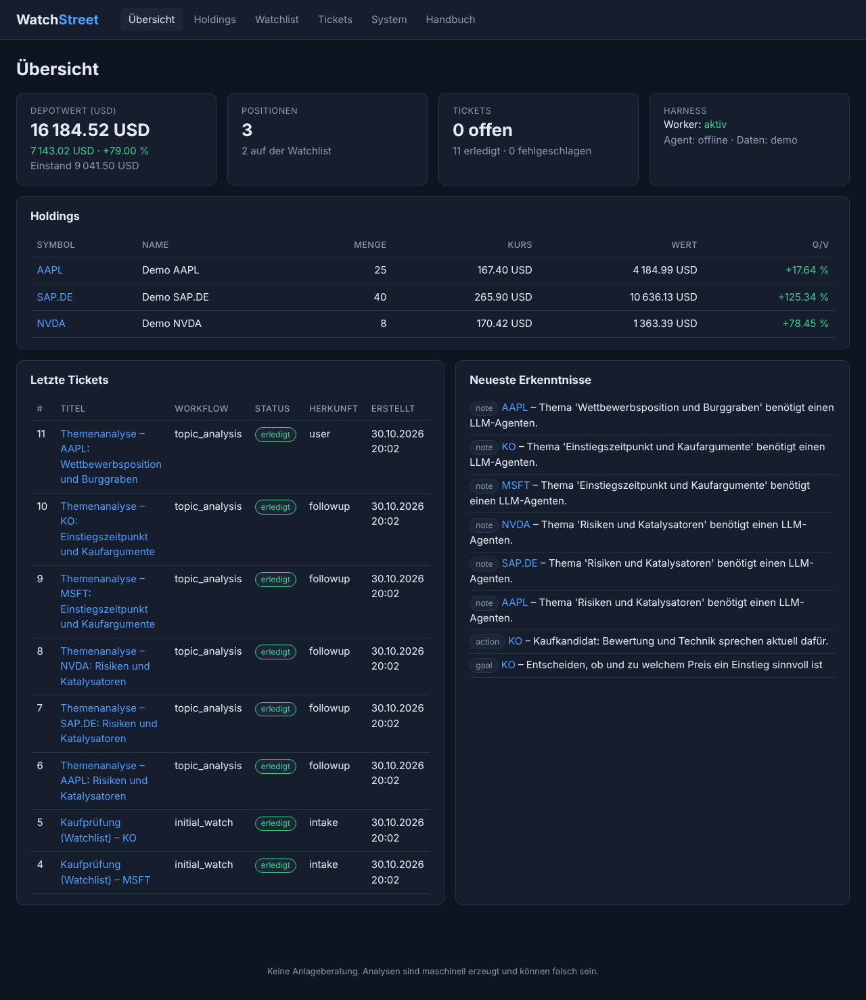
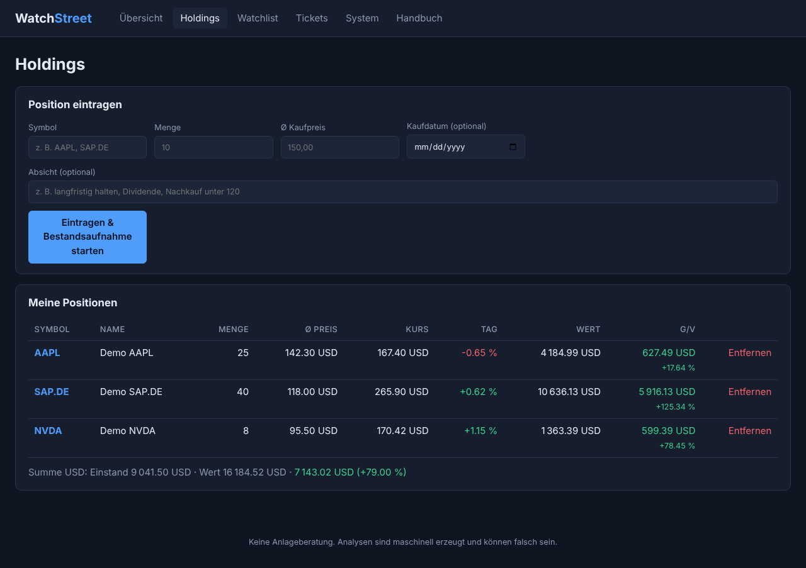
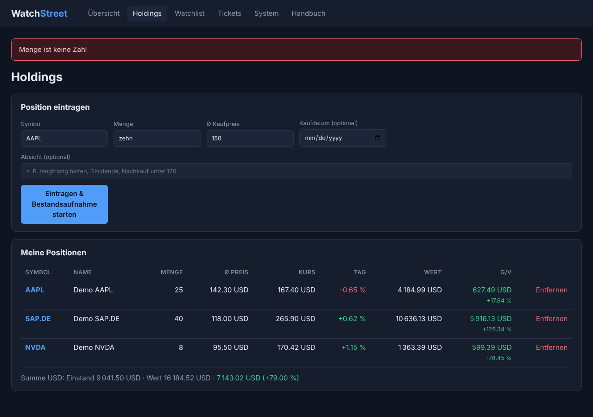
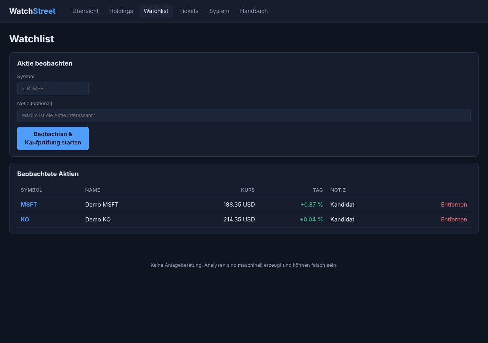
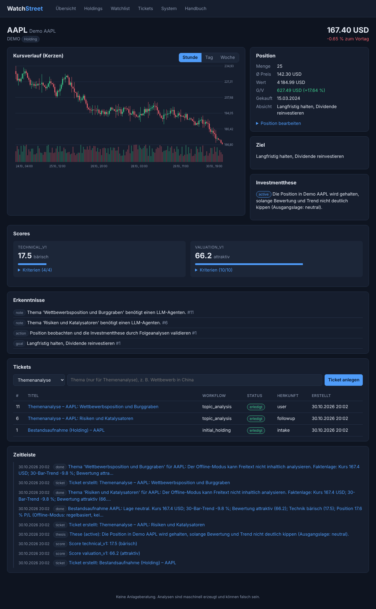
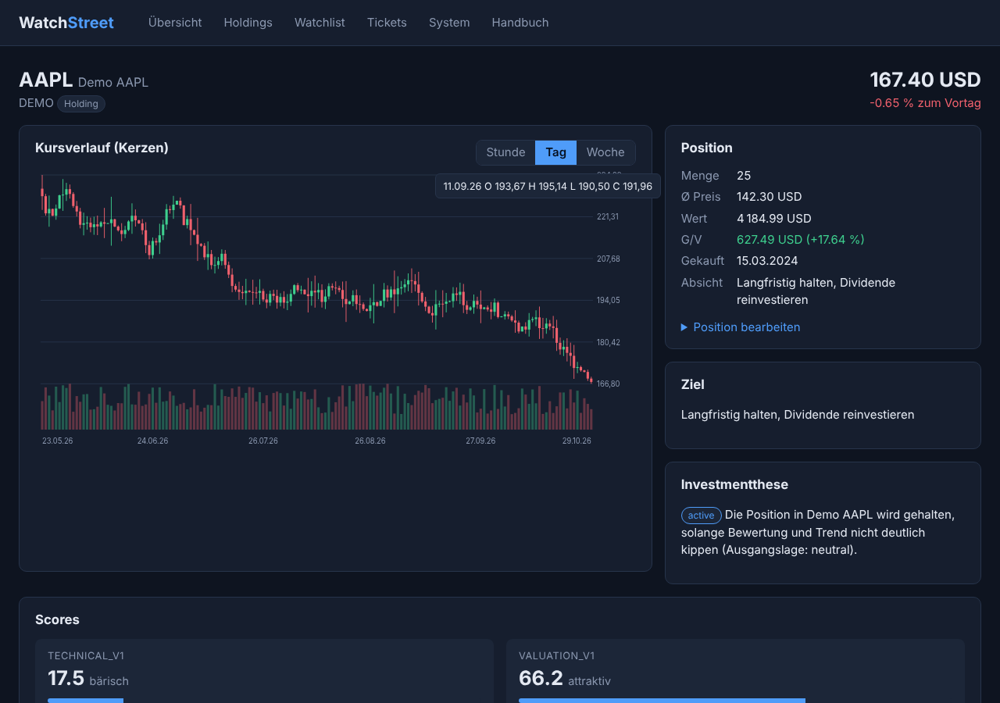
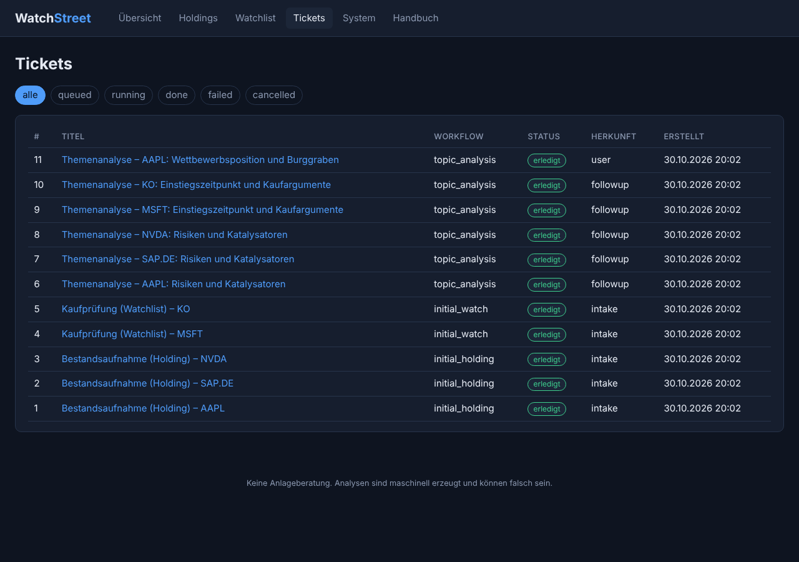
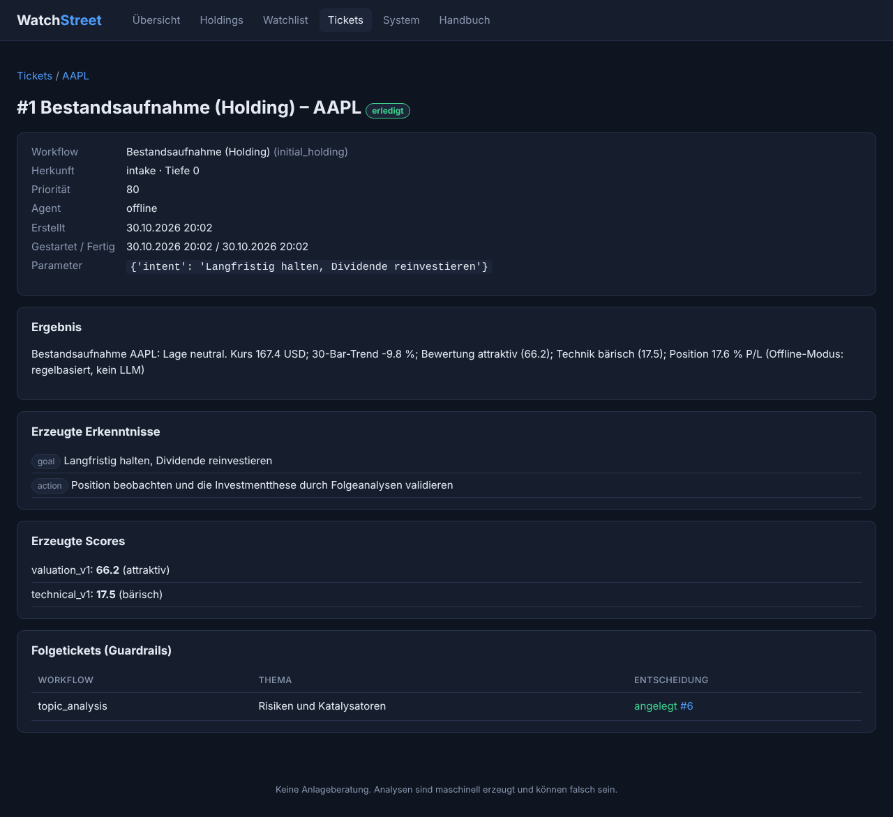
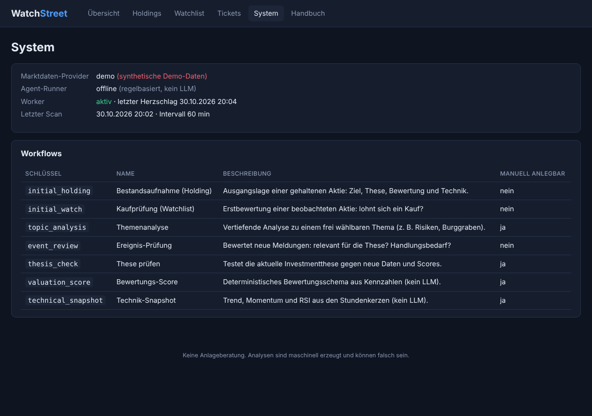

# WatchStreet – Benutzerhandbuch

WatchStreet überwacht deine Aktien. Du trägst ein, was du besitzt (**Holdings**) und was dich interessiert (**Watchlist**). Zu jeder Aktie legt das System **Tickets** an – Analyseaufträge, die automatisch von Agenten abgearbeitet werden. Die Erkenntnisse (Ziel, These, Scores, Hinweise) bleiben an der Aktie erhalten und wachsen mit der Zeit.

> **Hinweis zu den Screenshots:** Sie wurden mit dem Demo-Modus erzeugt (synthetische Kurse, regelbasierter Offline-Agent). Kurse und Texte sind also Beispiele und keine echten Marktdaten. **WatchStreet liefert keine Anlageberatung.**

## 1. Aufruf

Nach `docker compose up --build` ist die Anwendung unter **http://localhost:8000** erreichbar. Oben befindet sich die Navigation: *Übersicht, Holdings, Watchlist, Tickets, System, Handbuch*. Dieses Handbuch ist auch in der Anwendung unter **Handbuch** abrufbar.

## 2. Grundkonzepte

| Begriff | Bedeutung |
|---|---|
| **Holding** | Eine Aktie, die du besitzt: Menge, Ø-Kaufpreis, optional Kaufdatum und Absicht. |
| **Watchlist** | Eine Aktie, die du beobachtest, mit optionaler Notiz. |
| **Ticket** | Ein Auftrag mit genau einem vordefinierten **Workflow**. Status: wartend → läuft → erledigt / fehlgeschlagen / abgebrochen. |
| **Workflow** | Festes Ablaufschema eines Tickets (siehe Abschnitt 8). |
| **Erkenntnis** | Dauerhafte Aussage aus einem Ticket (Kategorien: Ziel, Risiko, Katalysator, Bewertung, Technik, Handlung, Notiz). |
| **Score** | Zahl 0–100 nach einem festen Schema. Jede Messung wird gespeichert, so entsteht ein Verlauf. |
| **These** | Die Investmentthese. Jede Prüfung legt eine neue Version mit Status an. |
| **Folgeticket** | Ein Ticket, das ein abgeschlossenes Ticket vorgeschlagen hat. |

## 3. Übersicht (Dashboard)

* **Depotwert** – Einstand, aktueller Wert und Gewinn/Verlust. Je Währung eine Karte; verschiedene Währungen werden nie zusammengerechnet.
* **Positionen** – Anzahl der Holdings und Watchlist-Einträge.
* **Tickets** – offene, erledigte und fehlgeschlagene Tickets.
* **Harness** – ob der Worker läuft, welcher Agent und welche Datenquelle aktiv sind.
* **Letzte Tickets** und **Neueste Erkenntnisse** – Klick führt zum Ticket bzw. zur Aktie.

## 4. Holdings

**Position eintragen:** Symbol (z. B. `AAPL`, `SAP.DE`; beim Tippen erscheinen Vorschläge), Menge, Ø-Kaufpreis (Komma oder Punkt), optional Kaufdatum und **Absicht** (z. B. „langfristig halten“). Mit *Eintragen & Bestandsaufnahme starten* wird die Position gespeichert und automatisch ein **Bestandsaufnahme-Ticket** angelegt. Ohne Absicht leitet der Agent ein Ziel selbst ab.

**Tabelle:** Kurs, Tagesänderung, Wert und Gewinn/Verlust je Position. Ein Klick auf das Symbol öffnet die Aktie. *Entfernen* löscht nur die Position; Tickets, Erkenntnisse und Thesen bleiben erhalten.

**Fehlermeldungen:** Ungültige Eingaben (z. B. Text statt Zahl, unbekanntes Symbol, doppelte Position) werden angezeigt, deine Eingaben bleiben im Formular stehen.

## 5. Watchlist

Symbol und optional eine Notiz eintragen. Es wird eine **Kaufprüfung** gestartet: Lohnt sich ein Kauf? Das Ergebnis und Folgeanalysen erscheinen an der Aktie. Eine Aktie kann gleichzeitig Holding und Watchlist-Eintrag sein.

## 6. Aktien-Detailseite

Die Seite bündelt alles Wissen zu einer Aktie:

1. **Kopf** – Kurs und Änderung zum Vortag.
2. **Kursverlauf (Kerzen)** – Candlestick-Chart mit Volumen. Umschalten zwischen *Stunde*, *Tag* und *Woche*; Mausover zeigt Open/High/Low/Close.
3. **Position** – Menge, Ø-Preis, Wert, Gewinn/Verlust. *Position bearbeiten* ändert Menge, Preis, Datum und Absicht.
4. **Ziel** – von dir angegeben oder vom Agenten abgeleitet.
5. **Investmentthese** – aktuelle Fassung mit Status (*active, confirmed, weakened, invalidated*). *Verlauf* zeigt alle Versionen und das verantwortliche Ticket.
6. **Scores** – `valuation_v1` (Bewertung aus Kennzahlen) und `technical_v1` (Trend/Momentum/RSI). *Kriterien* zeigt, wie der Wert zustande kam. Mit mehreren Messungen erscheint ein Verlauf.
7. **Erkenntnisse** – alle Hinweise, jeweils mit Link zum Ticket.
8. **Tickets** – Liste und Formular zum Anlegen eigener Tickets.
9. **Zeitleiste** – alles in zeitlicher Reihenfolge: Tickets, Ergebnisse, Thesen, Scores, Meldungen.

## 7. Tickets

Die Seite **Tickets** listet alle Tickets, filterbar nach Status.

**Eigenes Ticket anlegen** (Aktien-Seite): Workflow wählen, bei *Themenanalyse* ein Thema angeben (z. B. „Wettbewerb in China“).

**Ticket-Detail:** Workflow, Herkunft (*user, intake, followup, event, schedule*), Priorität, Agent, Zeiten, Parameter, Ergebnis, erzeugte Erkenntnisse und Scores sowie die **Folgetickets**. Dort steht auch, welche vorgeschlagenen Folgetickets die Leitplanken **verworfen** haben und warum. Aktionen: *Erneut ausführen* (fehlgeschlagen/abgebrochen), *Abbrechen* (wartend).

**Leitplanken für Folgetickets:** nur bekannte Workflows, maximal 2 Ebenen Tiefe, maximal 4 Folgetickets je Ticket, höchstens 8 offene Tickets je Aktie, keine Duplikate innerhalb von 24 Stunden.

## 8. Workflows

| Workflow | Zweck | LLM |
|---|---|---|
| Bestandsaufnahme (Holding) | Ausgangslage, Ziel, These, Scores; schlägt Folgetickets vor. Wird beim Eintragen automatisch angelegt. | ja |
| Kaufprüfung (Watchlist) | Lohnt sich ein Kauf? Wird beim Beobachten automatisch angelegt. | ja |
| Themenanalyse | Vertiefung zu einem frei wählbaren Thema. | ja |
| Ereignis-Prüfung | Bewertet neue Meldungen auf Relevanz für die These. Wird automatisch angelegt. | ja |
| These prüfen | Testet die These gegen neue Daten und Score-Änderungen; setzt den Thesen-Status. | ja |
| Bewertungs-Score | Deterministisches Schema aus Kennzahlen (KGV, KBV, PEG, Marge, ROE, Wachstum, Verschuldung, Dividende, Analysten-Potenzial). | nein |
| Technik-Snapshot | Deterministisch: Kurs vs. SMA50, SMA20 vs. SMA50, Momentum, RSI aus Stundenkerzen. | nein |

Scores werden aus den verfügbaren Kennzahlen berechnet und nur gebildet, wenn mindestens drei Kriterien vorliegen; die *Abdeckung* (z. B. 7/10) ist angegeben.

## 9. Automatik (Worker)

Der Worker läuft als eigener Container. Er

* arbeitet wartende Tickets nach Priorität ab (manuell/Intake vor Folge- und Zeitplan-Tickets),
* prüft **stündlich** (einstellbar) alle Aktien auf neue Meldungen und legt dafür eine Ereignis-Prüfung an,
* frischt Analysen auf: Technik-Snapshot täglich, Bewertungs-Score und These wöchentlich – nur für Aktien mit abgeschlossener Bestandsaufnahme,
* setzt nach einem Absturz hängende Tickets (> 30 min *läuft*) zurück in die Warteschlange.

## 10. System

Zeigt Datenquelle, Agent, Worker-Status, letzten Scan und alle Workflows.

**Datenquellen:** `yahoo` (kostenlos, ohne Schlüssel, Kurse stundengenau) oder `demo` (synthetisch, offline).
**Agenten (`WATCHSTREET_AGENT_RUNNER`):** `offline` (regelbasiert, kein LLM – kann Freitext-Themen nicht inhaltlich analysieren), `anthropic` (API-Schlüssel nötig), `openai` (OpenAI-kompatibel, z. B. lokales Ollama), `cli` (externer Agent per Kommandozeile, z. B. `claude -p`). Konfiguration in `.env`, siehe `.env.example`.

## 11. Grenzen und Hinweise

* Yahoo-Daten kommen aus einer inoffiziellen, kostenlosen Schnittstelle; sie kann sich ändern oder Anfragen begrenzen. Fehlende Kennzahlen führen zu weniger Kriterien, nicht zu erfundenen Werten.
* Zahlen und Texte können falsch sein. Keine Anlageberatung.
* Währungen werden nicht umgerechnet.
* Es gibt noch keine Benutzerverwaltung: Die Anwendung gehört in ein vertrauenswürdiges Netz.
