# WatchStreet – Benutzerhandbuch

WatchStreet ist ein kartenzentrierter Recherche-Arbeitsplatz für Rohstoffinvestments. Die Mine bzw. das
Projekt ist die Analyseeinheit; jede Zahl zeigt, woher sie stammt. WatchStreet gibt **keine
Anlageempfehlungen** und handelt nicht.

Im Demo-Modus (`make demo`) sind alle Objekte, Werte und Ereignisse **synthetisch** und entsprechend
markiert.

[TOC]

## 1. Aufbau

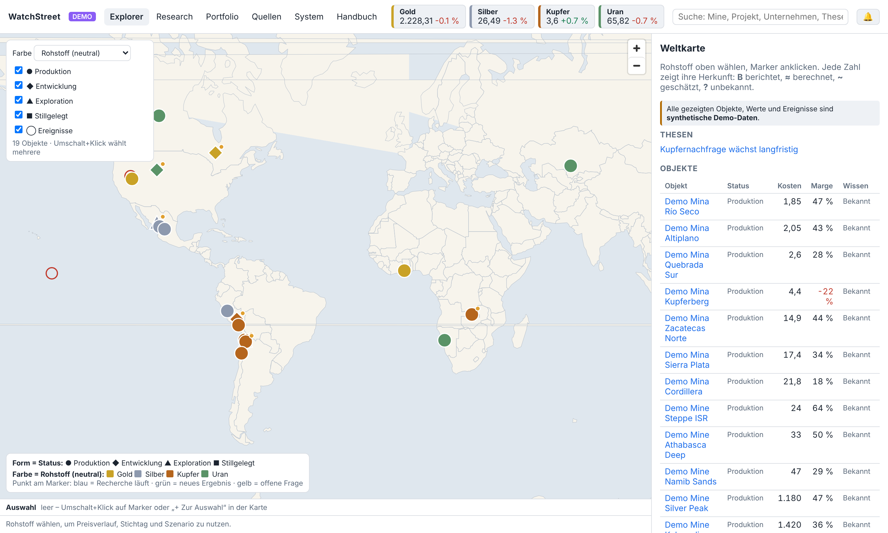

| Bereich | Zweck |
|---|---|
| Kopfzeile | Rohstoffleiste mit Preis, Navigation, Suche, Glocke für Ergebnisse |
| Karte | Minen und Projekte; Form = Status, Farbe = gewählter Farbmodus |
| Rechtes Panel | Übersicht oder Charakterkarte des gewählten Objekts |
| Auswahlleiste | mehrfach ausgewählte Objekte für den Vergleich |
| Zeitleiste | Preisverlauf, Stichtag, Replay, Szenariopreis |

Der gesamte Ansichtszustand steht in der Adresse; eine Ansicht lässt sich als Link weitergeben.

**Tastatur:** `Esc` schliesst das Panel, `c` öffnet den Vergleich, `Umschalt+Klick` auf einen Marker
fügt ihn der Auswahl hinzu.

## 2. Rohstoff wählen und Karte lesen

Ein Klick auf einen Rohstoff in der Kopfzeile filtert die Karte. Ein zweiter Klick hebt den Filter auf.

* **Form** zeigt den Status: ● Produktion, ◆ Entwicklung, ▲ Exploration, ■ stillgelegt/ruhend.
* **Farbe** zeigt den Farbmodus (Auswahl links oben): Rohstoff (neutral), Marge, Änderung im Szenario,
  Wissensstatus, Datenqualität.
* **Schraffiert-grau** bedeutet: für diesen Modus fehlen Daten. „Unbekannt“ wird nie wie ein mittlerer
  Wert eingefärbt.
* **Punkt am Marker:** blau = Recherche läuft, grün = neues Ergebnis, gelb = offene Frage.
* Die Kästchen links blenden Statusgruppen und Ereignisse (rote Ringe, z. B. Erdbeben) ein und aus.

## 3. Von der These zur Mine

Ein Klick auf eine These (rechts in der Übersicht oder im Bereich Research → „Auf der Karte zeigen“)
richtet die Karte auf die verknüpften Objekte aus.

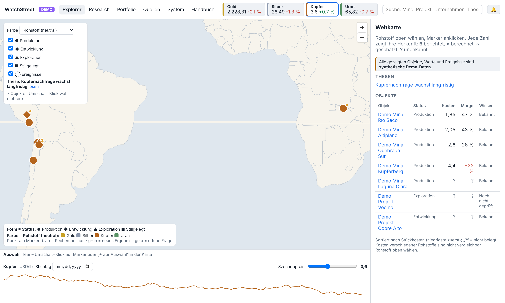

## 4. Charakterkarte

Ein Klick auf einen Marker oder einen Namen öffnet die Charakterkarte.

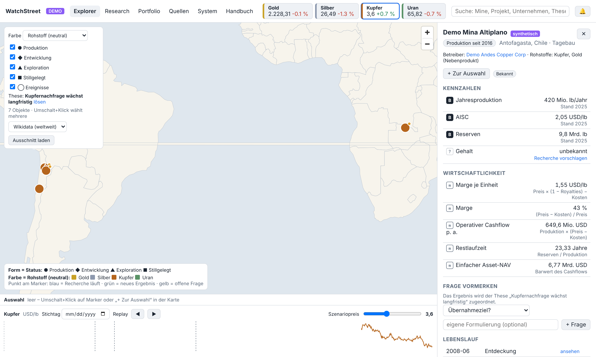

Jede Kennzahl trägt ein Herkunftszeichen:

| Zeichen | Bedeutung |
|---|---|
| **B** | berichtet – aus einem gespeicherten Dokument mit wörtlichem Zitat |
| **≈** | berechnet – aus anderen Kennzahlen, Formel wird genannt |
| **~** | geschätzt – immer als Bandbreite, mit benannter Methode |
| **?** | unbekannt – es wird nichts erfunden |

Kursive Werte sind Prognosen (z. B. Studienwerte eines Projekts). Produzierende Minen zeigen
Produktion, Kosten, Reserven; Projekte zeigen Studienwerte.

**Wirtschaftlichkeit** (Marge, Cashflow, Restlaufzeit, einfacher NAV) wird nur gerechnet, wenn Preis
und Stückkosten bekannt sind. Ist eine Eingabe geschätzt, ist auch das Ergebnis geschätzt und eine
Bandbreite.

### Herleitung einer Zahl

Ein Klick auf eine Kennzahl zeigt Wert, Definition, Zeitraum, Quelle, Zitat und frühere Werte.

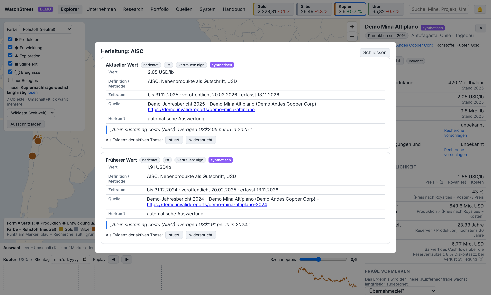

### Unternehmensansicht

Ein Klick auf den Betreiber öffnet die Unternehmensansicht. Die Objekte des Unternehmens bleiben auf
der Karte hervorgehoben, alle anderen abgedunkelt sichtbar; der Kartenausschnitt bleibt erhalten.

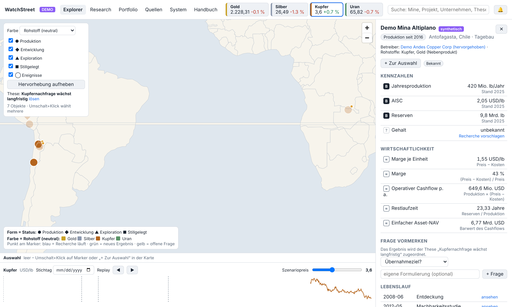

Die Ansicht beantwortet, ob das Unternehmen lange genug durchhält, um von seinen Objekten zu
profitieren:

| Abschnitt | Inhalt |
|---|---|
| Bilanz und Kapitalstruktur | Kasse, Finanzschulden, Mittelabfluss je Quartal, ausstehende und voll verwässerte Aktien, Insiderbesitz – jeweils mit Herkunftszeichen und Herleitung |
| Abgeleitet | Nettokasse, Reichweite in Monaten, Verwässerungsüberhang, Börsenwert, Summe der einfachen Asset-NAV (anteilig), Verhältnis Börsenwert zu Asset-NAV |
| Prüfkatalog | zehn Kernfragen mit Status „belegt“ oder offen; offene Punkte lassen sich als Recherche vormerken |
| Menschen | Führungspersonen mit Rolle und Erfolgsbilanz |
| Finanzierungen | Datum, Betrag, Preis je Aktie |
| Royalties und Streams | Belastungen auf den Objekten; sie mindern die Marge des Objekts |
| Preishebel | anteiliger Cashflow der produzierenden Objekte bei −50 % bis +50 % Rohstoffpreis |
| Eigene Angabe | eigene Werte eintragen; sie werden von Agenten nie überschrieben |

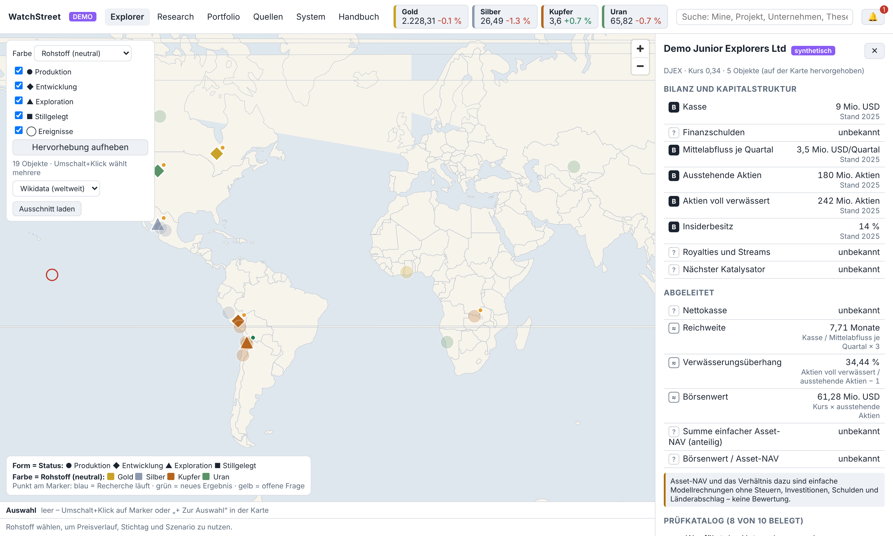

Reicht die Kasse weniger als zwölf Monate, legt die Regelprüfung eine Auffälligkeit und einen
Recherchevorschlag zur Finanzierung an. „Belegt“ im Prüfkatalog heisst, dass etwas vorliegt, nicht,
dass die Antwort gut ist. Asset-NAV und das Verhältnis dazu sind einfache Modellrechnungen, keine
Bewertung.

Ist eine These aktiv, lässt sich im Herleitungsdialog jede Kennzahl der These als stützende oder
widersprechende Evidenz zuordnen.

**Wie viel Geld ist heute noch da?** Die Bilanz ist immer alt. „Kasse heute (geschätzt)“ rechnet
deshalb vom Bilanzstichtag weiter: Kasse plus später erfasste Finanzierungen minus Mittelabfluss seither.
Alle abgeleiteten Werte – Nettokasse, Reichweite ab heute, Unternehmenswert, Finanzierungslücke –
stehen auf dieser einen Basis; Börsenwert und Verwässerungsüberhang rechnen mit den Aktien inklusive
später ausgegebener Aktien und Warrants. Darunter steht „Kasse rechnerisch leer am …“ oder, wenn das
Datum schon vorbei ist, „seit …“ mit Warnzeichen. Die berichteten Kennzahlen oben bleiben unverändert
auf dem Bilanzstichtag. Abgeleitete Werte sind gerundet („rund 8 Monate“): Sie sind grob, und
Nachkommastellen würden etwas anderes vortäuschen. Bei einem Stichtag in der Vergangenheit werden kein
Kurs und keine späteren Finanzierungen gezeigt.

**Finanzierungslücke und Unternehmenswert:** Unter „Abgeleitet“ stehen zusätzlich der Unternehmenswert
(Börsenwert + Finanzschulden − Kasse), der anteilige Capex der noch nicht produzierenden Projekte und
die Finanzierungslücke (Capex − Kasse, mindestens 0). Die Lücke zeigt, wie viel Kapital noch beschafft
werden muss – in aller Regel über neue Aktien. Personen und Finanzierungen lassen sich unter „Person
erfassen“ und „Finanzierung erfassen“ selbst eintragen; sie gelten als eigene Angabe ohne Quelle.
Eine Finanzierung braucht Datum (nicht in der Zukunft), Art und Betrag. Zusätzlich stehen der Börsenwert
voll verwässert und die Finanzierungslücke als Vielfaches des Börsenwerts in der Liste. Die Summe der
Asset-NAV nennt, aus wie vielen der produzierenden Objekte sie gebildet ist.

Eine **angekündigte** Finanzierung (Haken „nur angekündigt“) darf in der Zukunft liegen. Sie wird als
Was-wäre-wenn eingerechnet – Kasse, Aktienzahl, Überhang, Reichweite – und die Formel nennt, wie viele
der eingerechneten Finanzierungen nur angekündigt sind. „Letzte Finanzierung gegen heutigen Kurs“ zeigt
den Abschlag, „Finanzierungspreise“ die Folge der Preise; fallende Preise sind markiert.

Finanzierungen nehmen auch Warrants (Stück, Ausübungspreis, Laufzeit) und Zeichner auf. Liegt eine
Finanzierung nach dem Bilanzstichtag, erscheint zusätzlich „Aktien heute“, und alle abgeleiteten Werte
rechnen sie ein. Für Projekte stehen der NPV laut Studien (anteilig)
und das Verhältnis Börsenwert zu Studien-NPV in der Liste. Bei Personen lassen sich frühere
Unternehmen und der eigene Aktienbesitz erfassen. Eigene Personen und Finanzierungen lassen sich mit
„✕“ löschen. Ein Royalty-Halter erhält einen Wert aus seinem Umsatzanteil über die Reservenlaufzeit.

## 5. Auswahl und Vergleich

„+ Zur Auswahl“ oder `Umschalt+Klick` legt ein Objekt in die Auswahlleiste (höchstens 8). Ausgewählte
Objekte tragen auf der Karte ihre Nummer.

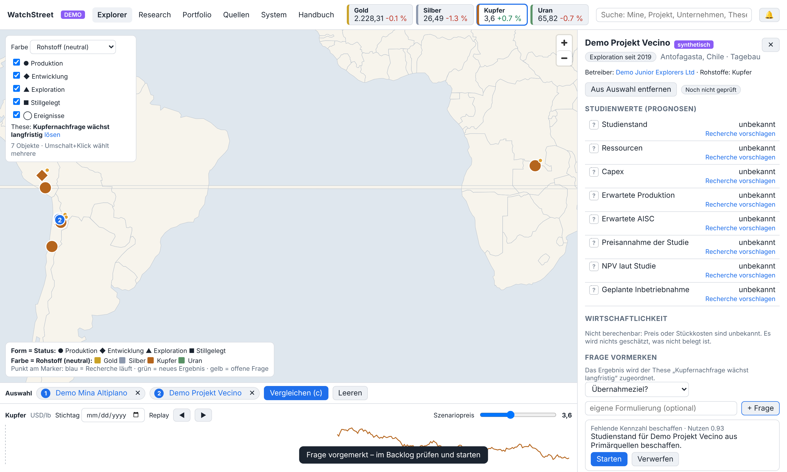

„Vergleichen“ stellt die Karten nebeneinander und zeigt die Lebensläufe ab einem gemeinsamen Anker
(„Jahr 0 = Entdeckung“ usw.). Beruhen Kosten auf unterschiedlichen Definitionen, erscheint ein Hinweis.

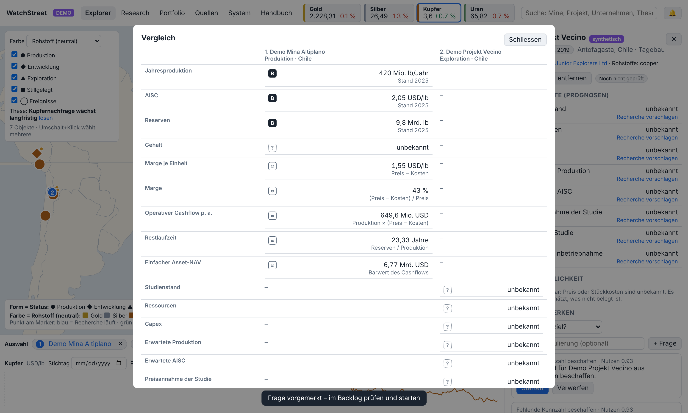

## 6. Fragen vormerken und Recherchen starten

Recherche läuft in zwei bewussten Schritten:

1. **Vormerken:** in der Charakterkarte unter „Frage vormerken“ (Vorlage wählen, optional eigene
   Formulierung) oder bei einer unbekannten Kennzahl über „Recherche vorschlagen“. Auch die
   Analyse-Engine legt Vorschläge an (fehlende Kennzahlen, Kostenausreisser, Nachbarschaft zu Minen
   anderer Betreiber).
2. **Starten:** im Bereich **Research → Backlog** oder direkt in der Charakterkarte. Erst jetzt läuft
   etwas.

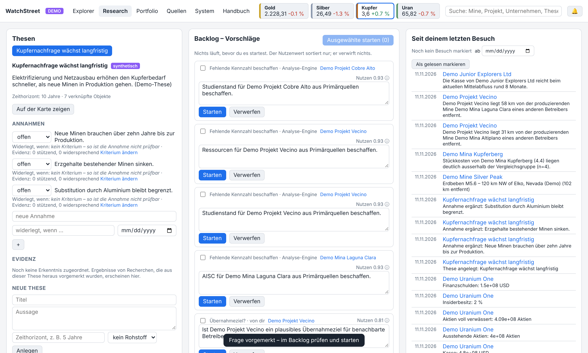

Im Backlog lässt sich der Auftragstext ändern, der Grund für die Reihenfolge einsehen (Maus auf ⓘ),
mehrere Vorschläge gesammelt starten oder ein Vorschlag verwerfen. Die Reihenfolge ist ein Vorschlag.

Während eine Recherche läuft, kann weiter erkundet werden. Fertige Ergebnisse meldet die Glocke; von
dort führt ein Klick zum Objekt.

### Beispiel: fehlende Kosten

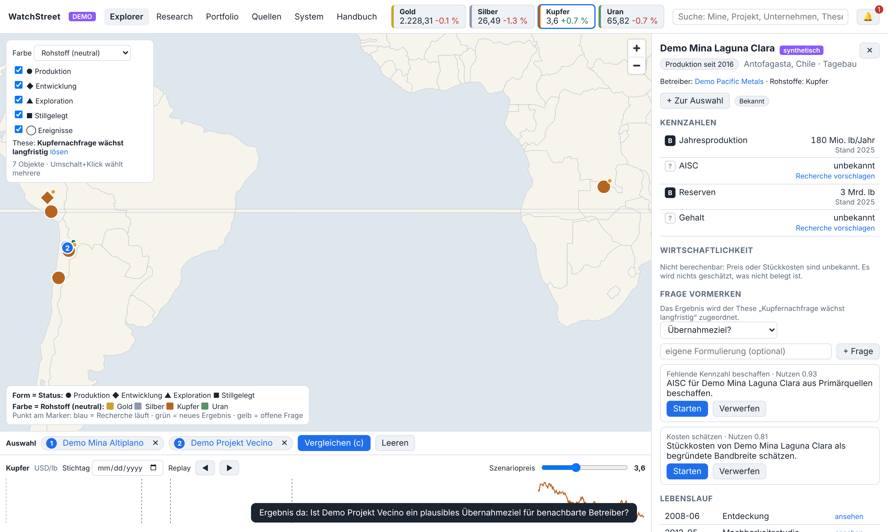

Nach dem Start durchsucht WatchStreet zuerst die gespeicherten Dokumente des Objekts. Wird die Zahl
gefunden, erscheint sie als berichteter Wert mit Zitat; daraus wird die Wirtschaftlichkeit berechnet.

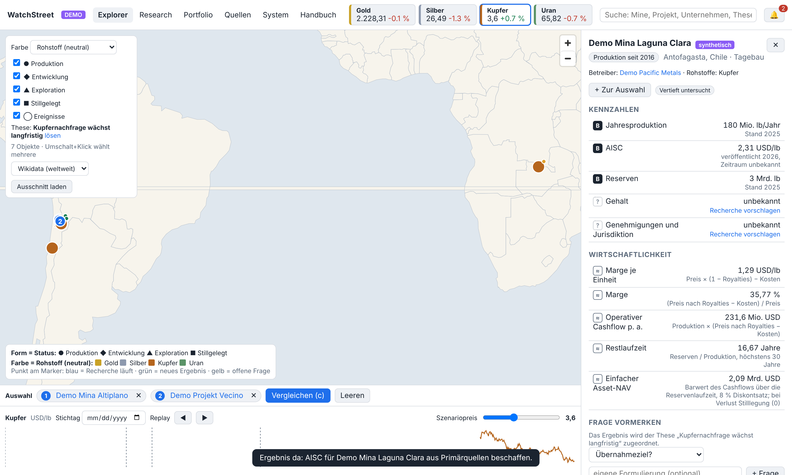
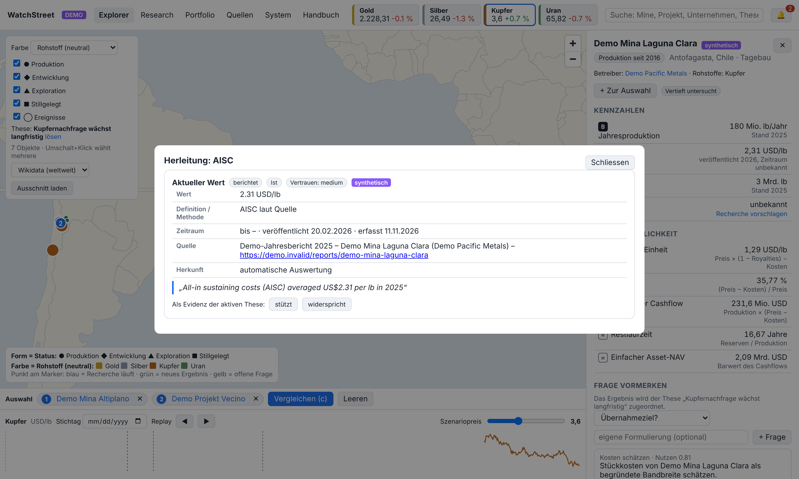

Mögliche Ergebnisse einer Recherche: berichteter Wert mit Zitat, geschätzte Bandbreite mit Methode,
oder ausdrücklich „nicht gefunden“.

### Vorlagen

| Vorlage | Was geschieht |
|---|---|
| Fehlende Kennzahl beschaffen | Suche in gespeicherten Dokumenten, danach (falls konfiguriert) Agent |
| Kosten schätzen | Bandbreite aus belegten Kosten vergleichbarer produzierender Minen (mindestens 3) |
| Übernahmeziel? / Strategische Bedeutung / Kostenstruktur erklären / Freie Frage | Agent bewertet anhand der bekannten Daten und Dokumente. Ohne Agent entsteht nur eine Zusammenstellung, ausdrücklich ohne Bewertung |
| Dokument lesen | siehe Abschnitt 9 |

## 7. Szenario und Stichtag

**Szenario:** Mit dem Regler „Szenariopreis“ in der Zeitleiste ändert sich der angenommene Preis des
gewählten Rohstoffs. Karte und Charakterkarten rechnen neu; ein Banner zeigt den Szenariomodus.
Das Banner nennt, wie viele produzierende Minen bei diesem Preis eine negative Marge haben, welchen
Anteil der Produktion das betrifft und für wie viele Minen Kostendaten fehlen. Die Übersicht rechts
listet die Objekte nach Stückkosten sortiert (niedrigste zuerst) mit ihrer Marge in dieser Ansicht.

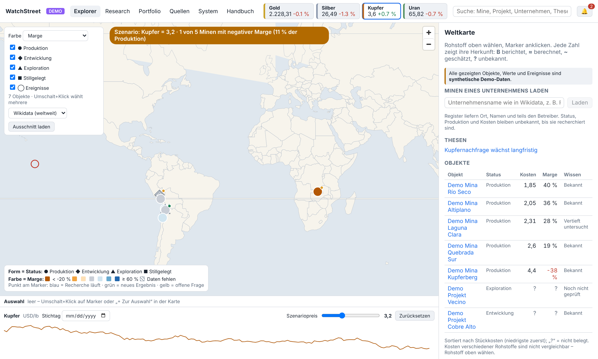

**Stichtag:** Ein Datum im Feld „Stichtag“ oder ein Klick in den Preisverlauf zeigt den damaligen
Stand. Die Auswahl daneben trennt zwei Sichten:

* **wie damals bekannt** – nur, was bis dahin veröffentlicht war. Kennzahlen ohne
  Veröffentlichungsdatum erscheinen hier nicht.
* **rückblickend bekannt** – alles über den Zeitraum, auch später Veröffentlichtes.

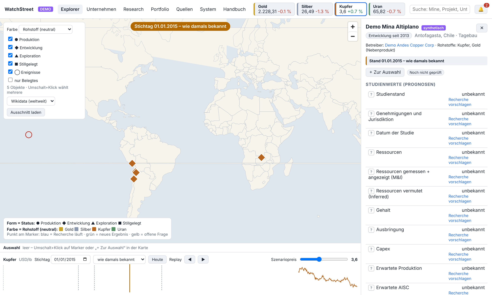

**Replay:** Ist ein Objekt geöffnet, springen ◀ ▶ von Meilenstein zu Meilenstein seines Lebenslaufs;
„ansehen“ im Lebenslauf setzt den Stichtag direkt.

Bei einem Stichtag in der Vergangenheit zeigt die Objektansicht nur, was damals vorlag: keine später
entstandenen Recherchen, Vorschläge oder Quellen, und der Wissensstatus leitet sich allein aus den
damals bekannten Kennzahlen ab.

## 8. Wissensstatus

Der Farbmodus „Wissensstatus“ zeigt je Objekt: noch nicht geprüft, bekannt, vertieft untersucht, neue
Entwicklung, veraltet. Der Status wird abgeleitet und nicht von Hand gepflegt. „Noch nicht geprüft“
heisst, dass nichts vorliegt, nicht, dass nichts existiert.

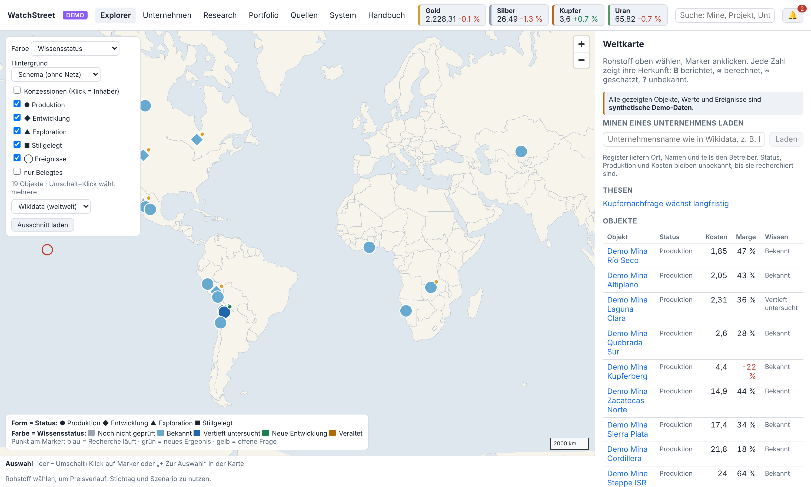

## 9. Research-Bereich

**Thesen:** Aussage, Zeithorizont, Annahmen mit Status (offen, gestützt, widerlegt, unklar) und
zugeordnete Evidenz. Ergebnisse von Fragen, die bei aktiver These vorgemerkt wurden, werden der These
zugeordnet und lassen sich als stützend, widersprechend oder Kontext einordnen.

Eine Annahme ist erst prüfbar, wenn feststeht, woran sie scheitern würde. Darum trägt jede Annahme
ein **Kriterium** („widerlegt, wenn …“) und ein **Prüfdatum**; ist das Datum überschritten, wird sie
als fällig markiert. Wer den Status auf gestützt, widerlegt oder unklar setzt, muss eine
**Begründung** angeben; sie steht bei der Annahme und im Lagebericht. Evidenz lässt sich einer
einzelnen Annahme zuordnen; an jeder Annahme steht, wie viele Belege sie stützen und wie viele ihr
widersprechen. „0 Gegenargumente“ heisst: es wurde noch keines gesucht.

**Recherchen:** Liste aller gestarteten Recherchen. Ein Klick öffnet das Ergebnis mit festen
Abschnitten: Antwort, Unsicherheiten, geprüfte Alternativen, nicht gefunden, abgelehnte Angaben des
Agenten, Folgefragen.

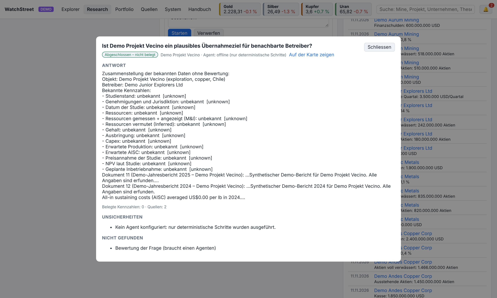

**Seit deinem letzten Besuch:** alle Änderungen (neue Kennzahlen mit altem und neuem Wert,
abgeschlossene Recherchen, Auffälligkeiten, Ereignisse). „Als gelesen markieren“ setzt den
Besuchszeitpunkt; mit „ab“ lässt sich ein anderes Vergleichsdatum wählen.

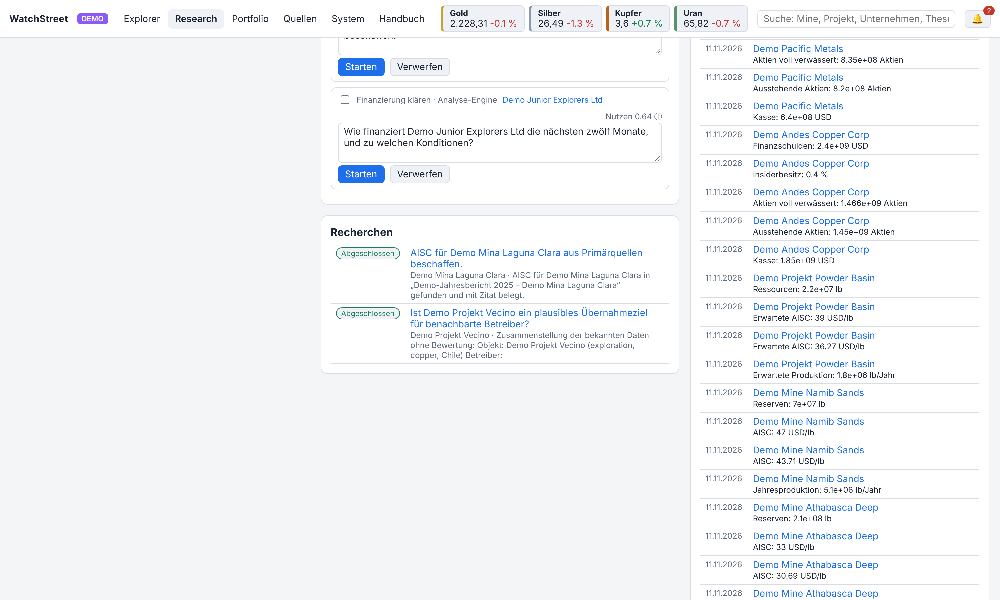

## 10. Portfolio

Bestände und Watchlist. Zu jeder Position gehören drei Angaben, die eine Entscheidung später
überprüfbar machen: die **These**, auf der sie beruht, die **Absicht** (warum du kaufst) und die
**Ausstiegsbedingung** (was eintreten müsste, damit du verkaufst). Fehlt eine davon, steht ein
Warnzeichen an der Position. Ein Kauf lässt sich nur mit Absicht und Ausstiegsbedingung erfassen.

Das **Entscheidungsprotokoll** hält jeden Kauf, jede Änderung der Ausstiegsbedingung und jeden Verkauf
fest, mit Begründung und dem damaligen Wissensstand: Kurs, Status der Annahmen der These und die
Unternehmenskennzahlen und die Kosten- und Studienwerte der Objekte zu diesem Zeitpunkt, mit dem
Vermerk „ungeprüft“, wo er galt. Änderungen und Verkäufe brauchen eine Begründung; die
alte Ausstiegsbedingung bleibt im Eintrag lesbar. Einträge lassen sich nicht ändern.
Unter „Absicht und Bezug“ steht zu jeder Position das erfasste Unternehmen, seine Objekte (mit Sprung
auf die Karte) und die Thesen, die sich auf das Unternehmen oder seine Objekte stützen. Eine Position
ohne These ist als solche ausgewiesen.

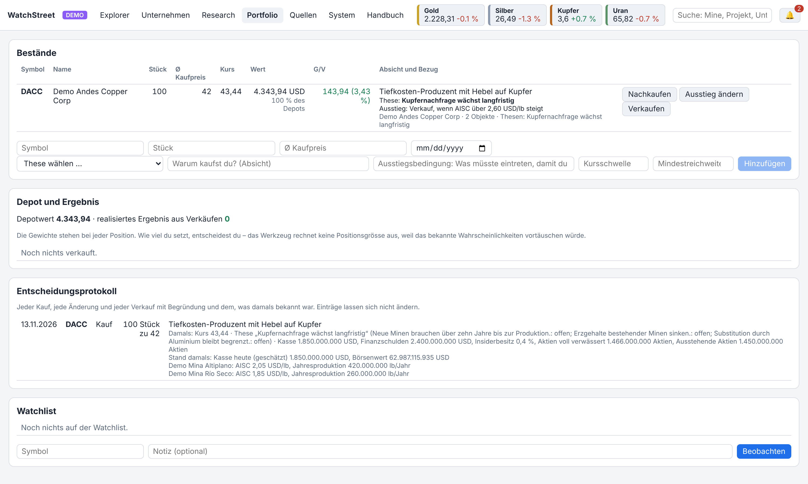

### Depot, Nachkauf, Teilverkauf und Ausstiegsschwellen

* **Depotwert und Gewichte:** Unter jeder Position steht ihr Anteil am Depot. Eine Positionsgrösse
  rechnet WatchStreet bewusst nicht aus.
* **Nachkaufen** und **Verkaufen** (auch teilweise) gehen nur mit Begründung. Beim Verkauf mit Preis
  wird das Ergebnis gegen den Durchschnittskaufpreis festgehalten; „Depot und Ergebnis“ listet alle
  Verkäufe und die Summe.
* **Ausstiegsschwellen:** Zusätzlich zum Text lassen sich eine Kursschwelle und eine Mindestreichweite
  in Monaten setzen. Ist eine Schwelle berührt oder eine Annahme der These widerlegt, steht „⚠ Ausstieg
  prüfen“ an der Position. WatchStreet verkauft nichts; es weist nur darauf hin.

## 10a. Unternehmen sichten

Die Seite „Unternehmen“ zeigt alle erfassten Unternehmen in einer Tabelle: Kasse heute (geschätzt),
Reichweite, Börsenwert, Verwässerungsüberhang, Finanzierungslücke, Datum „Kasse leer“, nächster Termin
und wie viele der zehn Prüffragen beantwortet sind. Ein Klick auf eine Spalte sortiert, ein Klick auf den
Namen öffnet die Unternehmensansicht. Eine Reichweite unter zwölf Monaten ist rot. Unternehmen mit
ungeprüften importierten Zahlen sind markiert.

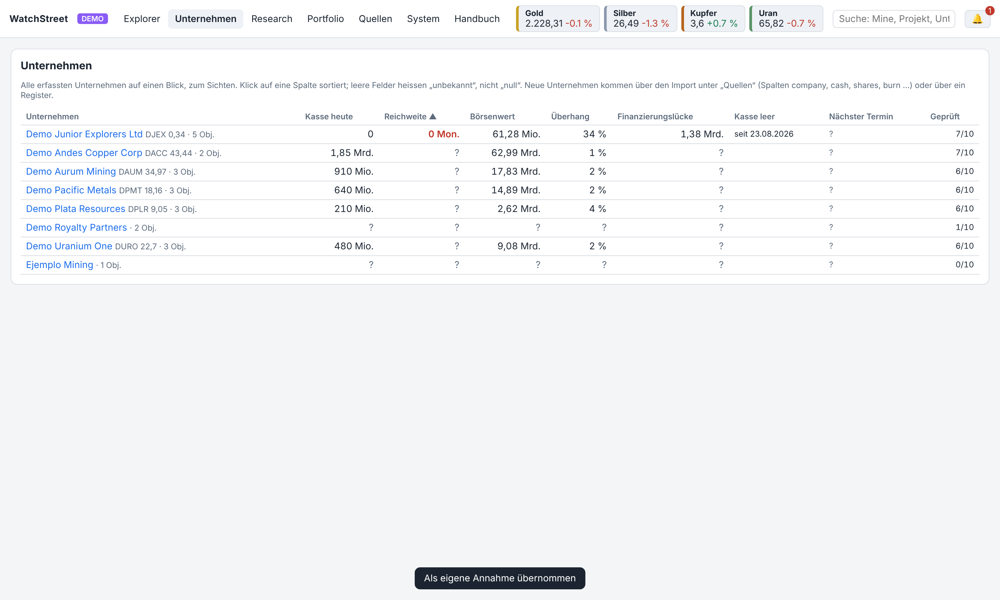

Auf dem Handy ordnen sich Kopfzeile, Karte und Ansichten untereinander an; breite Tabellen lassen sich
seitlich schieben.

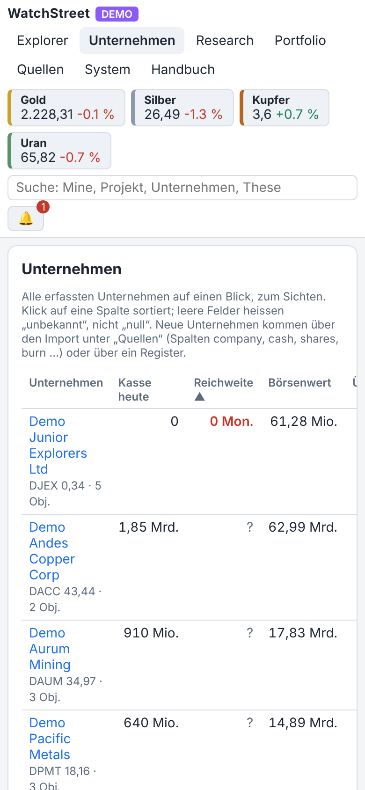

## 11. Quellen

Alle gespeicherten Dokumente. Ein Bericht lässt sich in der Charakterkarte unter „Quellen“ per Adresse
hinzufügen („Dokument lesen“): WatchStreet ruft ihn geschützt ab, speichert den Text und sucht
Kennzahlen darin.

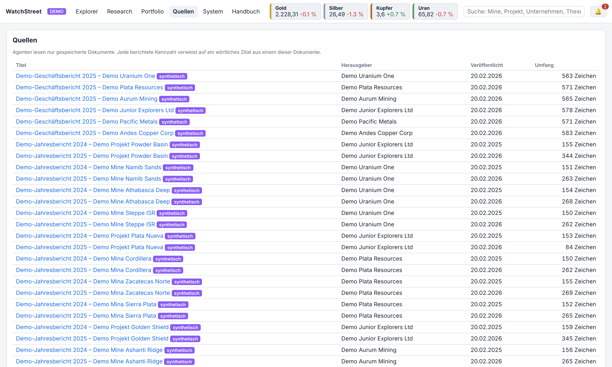

## 11a. Minen aus öffentlichen Registern laden

Ohne Demo-Modus startet die Karte leer. Standorte kommen aus öffentlichen Registern; alles Weitere
wird danach gezielt recherchiert („Lazy Research“).

| Weg | Bedienung | Quelle |
|---|---|---|
| Kartenausschnitt | Karte auf die Region zoomen, links Register wählen, „Ausschnitt laden“ (höchstens 25° Kantenlänge, 300 Einträge je Abruf) | Wikidata (weltweit, nennt teils Betreiber und Eigentümer) oder USGS MRDS (Lagerstättenverzeichnis des US Geological Survey) |
| Unternehmen | in der Übersicht den Unternehmensnamen eingeben, wie er in Wikidata heisst, „Laden“ | Wikidata: Minen, bei denen das Unternehmen als Betreiber oder Eigentümer eingetragen ist |

Der Abruf läuft im Hintergrund; die Glocke meldet das Ergebnis. Übernommen werden nur Einträge zu
Gold, Silber, Kupfer und Uran; bereits vorhandene Objekte werden nicht doppelt angelegt.

Ein Registerobjekt hat Ort, Namen und – falls genannt – Betreiber, jeweils mit dem Registereintrag als
Quelle. **Status, Produktion und Kosten bleiben unbekannt.** In der Charakterkarte führt „Profil
recherchieren“ zu einem Recherchevorschlag; Berichte lassen sich per Adresse hinzufügen. Registerobjekte
erscheinen nicht in Ansichten der Vergangenheit, weil sie keinen datierten Status haben.

Im Demo-Modus ist der Import gesperrt, damit synthetische und echte Daten nie in derselben Datenbank
liegen.

## 11b. Analysen importieren und nach und nach prüfen

Unter „Quellen“ lässt sich eine eigene Analyse oder Liste einfügen oder als Datei hochladen (CSV, TSV,
mit „;“ getrennt oder Markdown-Tabelle). Die Kopfzeile nennt mindestens `name`; ein neues Objekt
braucht zusätzlich `lat`, `lon` und `commodity`. Bekannte Objekte werden über den Namen gefunden.

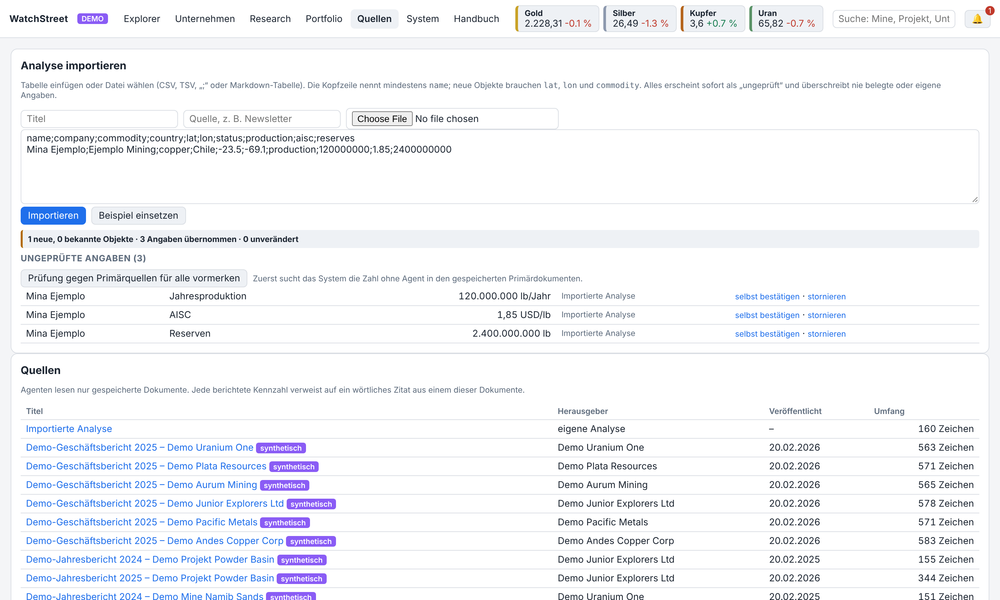

Was der Import bewirkt:

* Objekte und Kennzahlen erscheinen sofort, jede Kennzahl mit dem Hinweis **ungeprüft**.
* Eine importierte Zahl ersetzt nie eine belegte Zahl und nie deinen eigenen Eintrag. Nennt die
  Analyse etwas anderes, steht das als „Abweichung“ im Ergebnis.
* Derselbe Import noch einmal ändert nichts; ein neuer Import mit geänderten Werten ersetzt den alten.

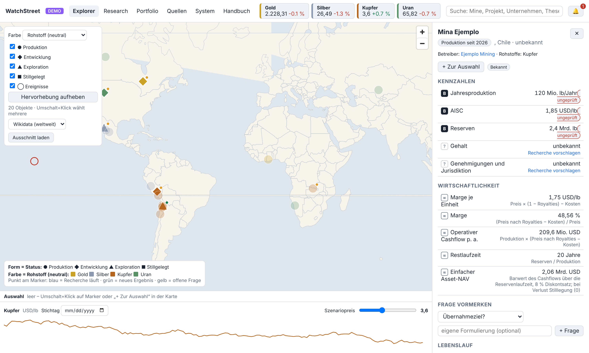

Prüfen lässt sich auf drei Wegen:

1. **Selbst bestätigen** (in der Liste oder in der Herleitung der Zahl): Du gibst an, woher du weisst,
   dass die Angabe stimmt. Sie gilt danach als dein Eintrag, bleibt aber als „eigene Annahme“ markiert
   und behält niedriges Vertrauen – eine Bestätigung ist keine Primärquelle.
2. **Stornieren**: Die Angabe zählt nicht mehr, bleibt aber in der Historie sichtbar; der Wert, den sie
   ersetzt hatte, gilt wieder. Das geht auch für eigene Einträge, etwa nach einem Tippfehler.
3. **Prüfung gegen Primärquellen vormerken**: Je Angabe entsteht ein Vorschlag im Research-Backlog.
   Nach dem Start sucht das System die Zahl zuerst ohne Sprachmodell in den gespeicherten
   Primärdokumenten; erst wenn das nichts ergibt, arbeitet der eingestellte Agent.

Mit dem Schalter **„nur Belegtes“** in der Kartenlegende lassen sich importierte und nur selbst
bestätigte Zahlen ganz ausblenden: Karte, Kostenrangliste, Marge, NAV und Unternehmenssummen rechnen
dann nur mit belegten Angaben.

Ungeprüfte Zahlen wirken weiter, und das ist sichtbar: Marge, Cashflow, NAV und die
Unternehmenssummen, die auf einer ungeprüften oder nur selbst bestätigten Zahl beruhen, tragen
ebenfalls „ungeprüft“; die Kostenrangliste markiert solche Minen, und das Szenario-Banner nennt, wie
viele Minen mit ungeprüften Zahlen mitgezählt sind. Ein Objekt, zu dem nur Importiertes vorliegt, gilt
weiter als „noch nicht geprüft“. Nennt eine Analyse etwas anderes als eine belegte Zahl, bleibt das als
Auffälligkeit am Objekt stehen. Nicht plausible Werte (negativ, null, Prozent über 100) werden nicht
übernommen.

Auch Unternehmenszahlen lassen sich importieren: Eine Zeile mit `company` und Spalten wie `cash`,
`debt`, `burn`, `shares`, `shares_diluted`, `insider` oder `katalysator` legt das Unternehmen an und
trägt die Zahlen als ungeprüft ein – auch ohne Mine in derselben Zeile. Spalten, die WatchStreet nicht
kennt, nennt das Importergebnis ausdrücklich.

Fliesstext ohne Tabelle zerlegt der Agent in einem Aufruf; jede Zeile braucht ein wörtliches Zitat aus
dem Text. Skripte und Research-Agenten ausserhalb der Anwendung nutzen dieselbe Funktion über die
[Import-API](import-api.md).

## 12. System

Unter „Agent“ wählst du, wer Recherchen ausführt: kein Agent, die Anthropic-API oder ein
OpenAI-kompatibler Server (ein API-Anbieter oder ein Modell auf eigener Hardware, etwa Ollama). Modell,
Adresse und Schlüssel werden hier eingetragen; „Verbindung testen“ schickt eine kurze Anfrage. Der
Schlüssel wird in der Datenbank des Servers gespeichert und nicht wieder angezeigt.

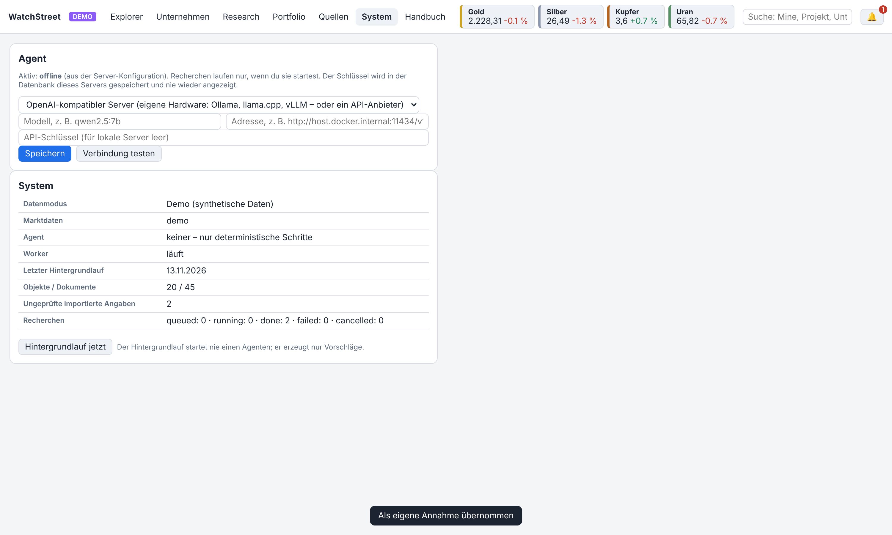

Datenmodus, Marktdatenquelle, konfigurierter Agent, Zustand des Workers. „Hintergrundlauf jetzt“
aktualisiert Preise und Ereignisse und führt die Regelprüfung aus; er startet nie einen Agenten.

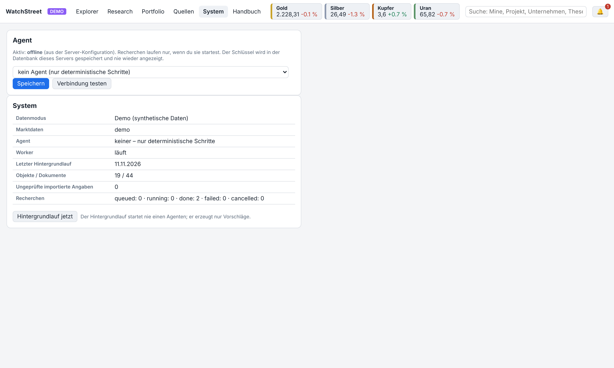

## 13. Betrieb

| Zweck | Befehl |
|---|---|
| Demo ohne Netz und Schlüssel | `make demo` → http://localhost:8000 |
| Mit Docker und PostgreSQL | `docker compose up --build` |
| Öffentlich mit HTTPS und Anmeldung | siehe `docs/deployment.md` |
| Lokales Modell (llama.cpp) | `docker compose --profile llm-cpu up --build` bzw. `llm-gpu`, dazu `WATCHSTREET_AGENT_RUNNER=llama` |

Einstellungen stehen in `.env.example`. Ohne konfigurierten Agenten (`offline`) arbeitet WatchStreet
nur mit deterministischen Schritten.

**Sicherung:** bei PostgreSQL `docker compose exec db pg_dump -U watchstreet watchstreet > backup.sql`;
vor einem Update immer sichern, denn Migrationen sind nicht in jedem Fall umkehrbar.

## 13a. Glossar

| Begriff | Bedeutung in einem Satz |
|---|---|
| AISC | „All-in Sustaining Costs“: was die Förderung einer Einheit kostet, inklusive der Investitionen, um die Mine am Laufen zu halten |
| Cash Cost | reine Betriebskosten je Einheit, ohne Erhaltungsinvestitionen – immer niedriger als AISC |
| Reserven | der Teil der Lagerstätte, dessen Abbau nach einer Studie wirtschaftlich ist |
| Ressourcen (M&I, Inferred) | geschätzte Menge im Boden; „Measured & Indicated“ ist besser belegt, „Inferred“ nur vermutet |
| Gehalt, Ausbringung | wie viel Metall im Gestein steckt und wie viel davon die Anlage herausholt |
| PEA, PFS, FS | Studienstufen eines Projekts, von der ersten Abschätzung (PEA) bis zur Machbarkeitsstudie (FS) |
| Capex | Investition, um ein Projekt zu bauen |
| NPV | heutiger Wert der künftigen Zahlungen eines Projekts laut Studie – hängt stark von der Preisannahme ab |
| NAV | hier: einfacher Barwert des Cashflows einer Mine über die Reservenlaufzeit |
| EV (Unternehmenswert) | Börsenwert plus Schulden minus Kasse: was ein Käufer für das Geschäft zahlt |
| Mittelabfluss (Burn) | Geld, das ein Unternehmen ohne Einnahmen je Quartal verbraucht |
| Reichweite | Monate, bis die Kasse bei diesem Mittelabfluss leer ist |
| Verwässerung | neue Aktien senken deinen Anteil am Unternehmen |
| Verwässerungsüberhang | Optionen und Warrants, die noch zu Aktien werden können, im Verhältnis zu den ausstehenden Aktien |
| Warrant | Recht, bis zu einem Datum Aktien zu einem festen Preis zu kaufen; oft Beigabe einer Finanzierung |
| Royalty, Stream | Anspruch auf einen Teil des Umsatzes oder der Produktion einer Mine, ohne sie zu betreiben |
| Zeichen an Kennzahlen | **B** belegt mit wörtlichem Zitat · **≈** berechnet oder geschätzt · **N** aus einer importierten Analyse, ungeprüft · **E** eigene Annahme · **?** unbekannt |

## 14. Grenzen des aktuellen Stands

* Marge, Cashflow und NAV sind einfache Modellrechnungen (Preis nach Royalties minus Stückkosten,
  8 % Diskontsatz, konstante Produktion) ohne Steuern, Investitionen und Schulden – keine Bewertung.
  Liegt der Preis unter den Kosten, rechnet der NAV mit Stilllegung (0) statt mit Dauerverlust.

* Register liefern nur Ort, Namen und teils Betreiber. Der USGS-Abruf ist mit echten Daten geprüft; der
  Wikidata-Abruf ist gegen aufgezeichnete echte Antworten geprüft, wurde in der Entwicklungsumgebung
  aber von Wikidata abgewiesen (Bot-Richtlinie) und ist im Betrieb noch zu bestätigen.
* Noch nicht vorhanden: Marker-Clustering, Standortbilder, Inflations- und
  Rohstoffäquivalent-Spalten im Vergleich.
* Die Zitatprüfung stellt sicher, dass ein Zitat wörtlich im Dokument steht, nicht, dass es die Zahl
  inhaltlich richtig belegt.
