# WatchStreet – Benutzerhandbuch

WatchStreet ist ein kartenzentrierter Recherche-Arbeitsplatz für Rohstoffinvestments. Die Mine bzw. das
Projekt ist die Analyseeinheit; jede Zahl zeigt, woher sie stammt. WatchStreet gibt **keine
Anlageempfehlungen** und handelt nicht.

Im Demo-Modus (`make demo`) sind alle Objekte, Werte und Ereignisse **synthetisch** und entsprechend
markiert. Einzige Ausnahme sind die Makro-Reihen: sie sind echte Daten der FRED-Datenbank, siehe
Abschnitt 10b.

[TOC]

## 1. Aufbau

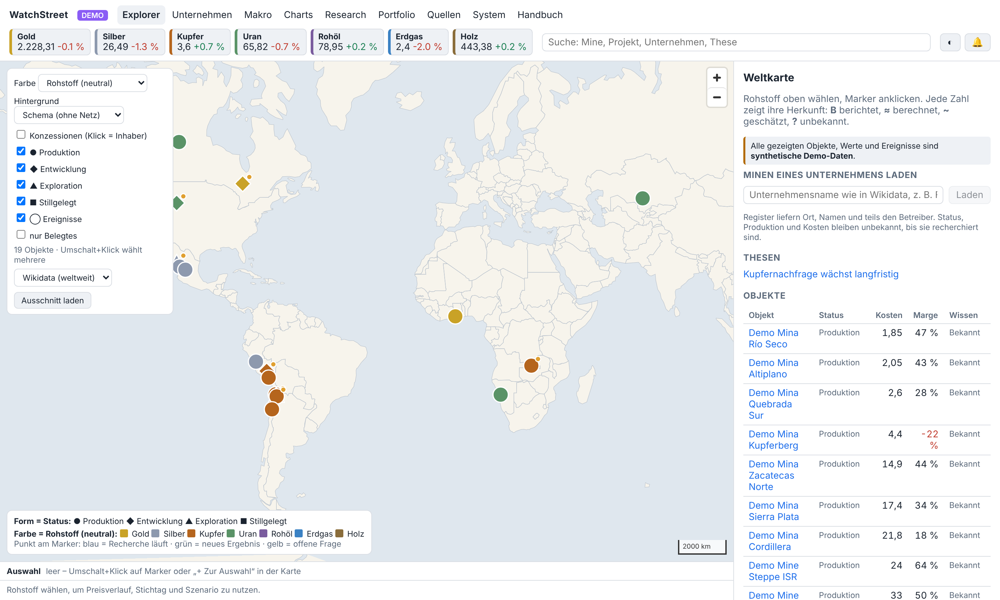

| Bereich | Zweck |
|---|---|
| Kopfzeile | Navigation, Rohstoffleiste mit Preis, Suche, Umschalter Hell/Dunkel, Glocke für Ergebnisse |
| Karte | Minen und Projekte; Form = Status, Farbe = gewählter Farbmodus |
| Rechtes Panel | Übersicht oder Charakterkarte des gewählten Objekts |
| Auswahlleiste | mehrfach ausgewählte Objekte für den Vergleich |
| Zeitleiste | Preisverlauf, Stichtag, Replay, Szenariopreis |

Der gesamte Ansichtszustand steht in der Adresse; eine Ansicht lässt sich als Link weitergeben.

**Darstellung:** Der Knopf neben der Glocke schaltet zwischen „Automatisch“ (wie das System, ◐),
„Hell“ (☀) und „Dunkel“ (☾). Die Wahl bleibt in diesem Browser gespeichert.

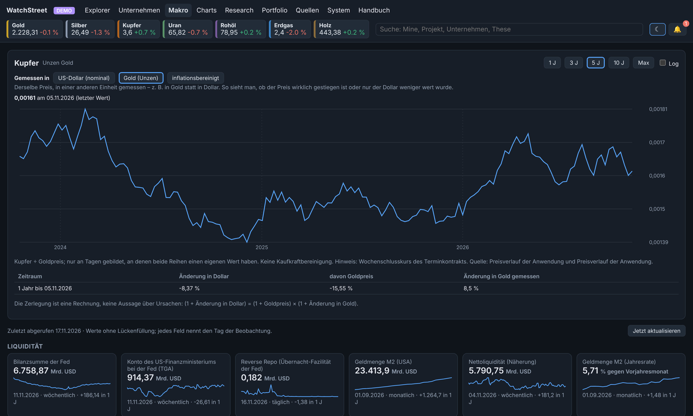

**Tastatur:** `Esc` schliesst das Panel, `c` öffnet den Vergleich, `Umschalt+Klick` auf einen Marker
fügt ihn der Auswahl hinzu.

## 2. Rohstoff wählen und Karte lesen

Ein Klick auf einen Rohstoff in der Kopfzeile filtert die Karte. Ein zweiter Klick hebt den Filter auf.
Geführt werden Gold, Silber, Kupfer, Uran, Rohöl, Erdgas und Holz. Für Rohöl, Erdgas und Holz gibt
es bisher Preis, Szenario und Makro-Reihen, aber noch keine Objekte auf der Karte.

* **Hintergrund** (Auswahl links auf der Karte): „Karte“ zeigt Orte, Strassen und Gewässer
  (OpenFreeMap, Daten von OpenStreetMap), „Gelände“ zusätzlich Höhenlinien und Relief (OpenTopoMap, bis etwa Massstab
  1:25 000) – gedacht für den Blick auf benachbarte Vorkommen im Umkreis weniger Kilometer. Der
  Massstab steht unten rechts. Die Kacheln lädt dein Browser direkt beim Kartenanbieter; dieser
  sieht dabei deine IP-Adresse und den Kartenausschnitt, aber keine Inhalte aus WatchStreet.
  „Schema“ kommt ohne Netz aus und zeigt nur Ländergrenzen. Die Wahl merkt sich der Browser.
* **Konzessionen** (Häkchen links auf der Karte) legt die amtlichen Register für Claims und
  Abbaurechte über die Karte, derzeit für British Columbia, Ontario, Westaustralien
  und US-Bundesland (BLM, vor allem Weststaaten). Das US-Register nennt im Kartendienst nur Claim-Name,
  Nummer und Status; den Inhaber findest du über die Nummer im Register selbst. Ontario nennt den
  Inhaber nur für Claims, nicht für Leases und Patente. Die Flächen
  erscheinen ab Regionalmassstab. Ein Klick auf eine Fläche fragt das Register live ab und zeigt
  Inhaber, Art des Titels, Nummer, Fläche und Ablaufdatum. „Zum Objekt zoomen“ springt auf die
  Umgebung des geöffneten Objekts. Die Angaben werden nur angezeigt, nicht gespeichert; im
  Demo-Modus wird kein Register abgefragt. Ein Titel im Register sagt, wem das Recht gehört, nicht,
  ob dort eine Lagerstätte liegt, und Optionen oder Royalties auf dem Grund stehen dort nicht.

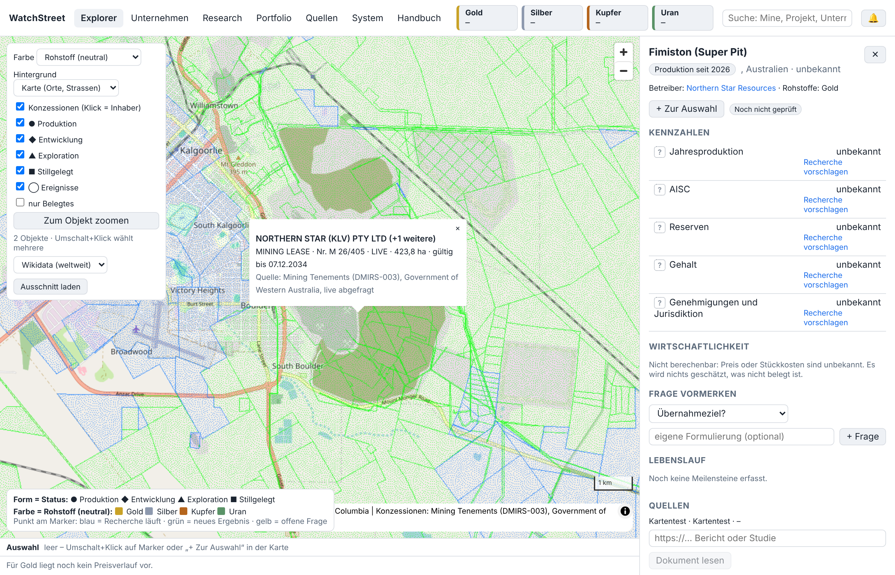

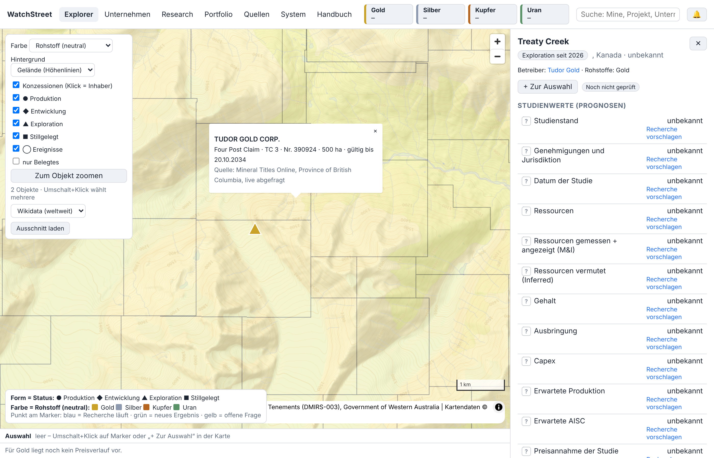

* **Form** zeigt den Status: ● Produktion, ◆ Entwicklung, ▲ Exploration, ■ stillgelegt/ruhend.
* **Farbe** zeigt den Farbmodus (Auswahl links oben): Rohstoff (neutral), Marge, Änderung im Szenario,
  Wissensstatus, Datenqualität.
* **Schraffiert-grau** bedeutet: für diesen Modus fehlen Daten. „Unbekannt“ wird nie wie ein mittlerer
  Wert eingefärbt.
* **Punkt am Marker:** blau = Recherche läuft, grün = neues Ergebnis, gelb = offene Frage.
* Die Kästchen links blenden Statusgruppen und Ereignisse (rote Ringe, z. B. Erdbeben) ein und aus.

## 3. Von der These zur Mine

Ein Klick auf eine These (rechts in der Übersicht oder im Bereich Research → „Auf der Karte zeigen“)
richtet die Karte auf die verknüpften Objekte aus.

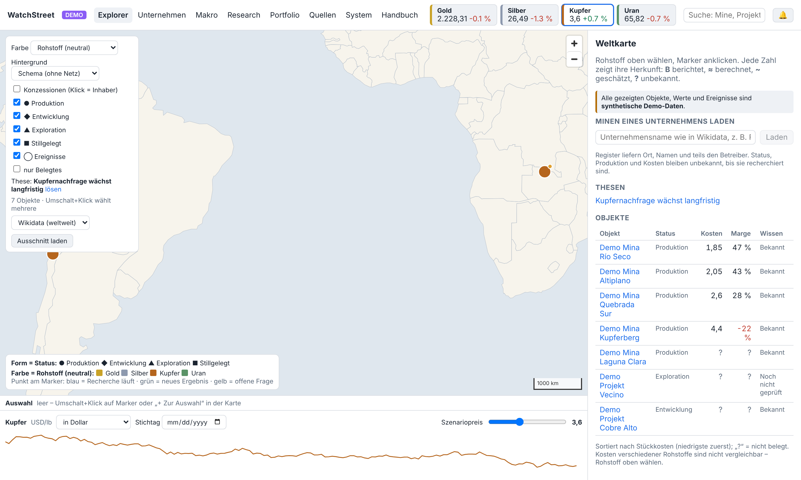

## 4. Charakterkarte

Ein Klick auf einen Marker oder einen Namen öffnet die Charakterkarte.

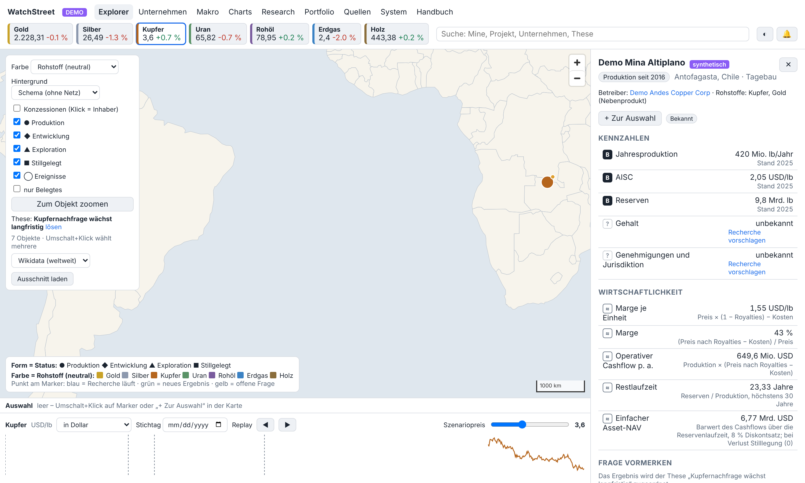

Jede Kennzahl trägt ein Herkunftszeichen:

| Zeichen | Bedeutung |
|---|---|
| **B** | berichtet – aus einem gespeicherten Dokument mit wörtlichem Zitat |
| **≈** | berechnet – aus anderen Kennzahlen, Formel wird genannt |
| **~** | geschätzt – immer als Bandbreite, mit benannter Methode |
| **?** | unbekannt – es wird nichts erfunden |

Kursive Werte sind Prognosen (z. B. Studienwerte eines Projekts). Produzierende Minen zeigen
Produktion, Kosten, Reserven; Projekte zeigen Studienwerte.

**Wirtschaftlichkeit** (Marge, Cashflow, Restlaufzeit, einfacher NAV) wird nur gerechnet, wenn Preis
und Stückkosten bekannt sind. Ist eine Eingabe geschätzt, ist auch das Ergebnis geschätzt und eine
Bandbreite.

### Herleitung einer Zahl

Ein Klick auf eine Kennzahl zeigt Wert, Definition, Zeitraum, Quelle, Zitat und frühere Werte.

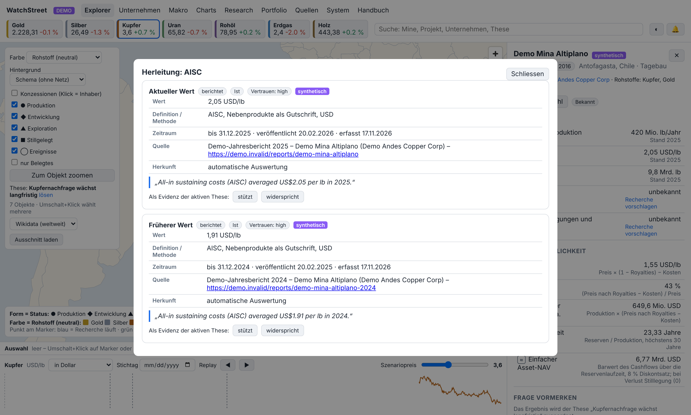

### Unternehmensansicht

Ein Klick auf den Betreiber öffnet die Unternehmensansicht. Die Objekte des Unternehmens bleiben auf
der Karte hervorgehoben, alle anderen abgedunkelt sichtbar; der Kartenausschnitt bleibt erhalten.

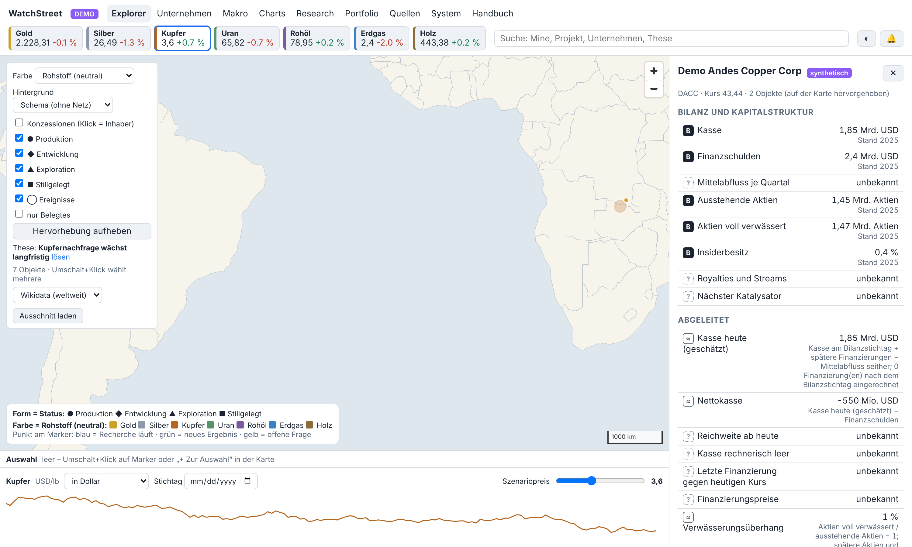

Die Ansicht beantwortet, ob das Unternehmen lange genug durchhält, um von seinen Objekten zu
profitieren:

| Abschnitt | Inhalt |
|---|---|
| Bilanz und Kapitalstruktur | Kasse, Finanzschulden, Mittelabfluss je Quartal, ausstehende und voll verwässerte Aktien, Insiderbesitz – jeweils mit Herkunftszeichen und Herleitung |
| Abgeleitet | Nettokasse, Reichweite in Monaten, Verwässerungsüberhang, Börsenwert, Summe der einfachen Asset-NAV (anteilig), Verhältnis Börsenwert zu Asset-NAV |
| Prüfkatalog | zehn Kernfragen mit Status „belegt“ oder offen; offene Punkte lassen sich als Recherche vormerken |
| Menschen | Führungspersonen mit Rolle und Erfolgsbilanz |
| Finanzierungen | Datum, Betrag, Preis je Aktie |
| Royalties und Streams | Belastungen auf den Objekten; sie mindern die Marge des Objekts |
| Preishebel | anteiliger Cashflow der produzierenden Objekte bei −50 % bis +50 % Rohstoffpreis |
| Eigene Angabe | eigene Werte eintragen; sie werden von Agenten nie überschrieben |

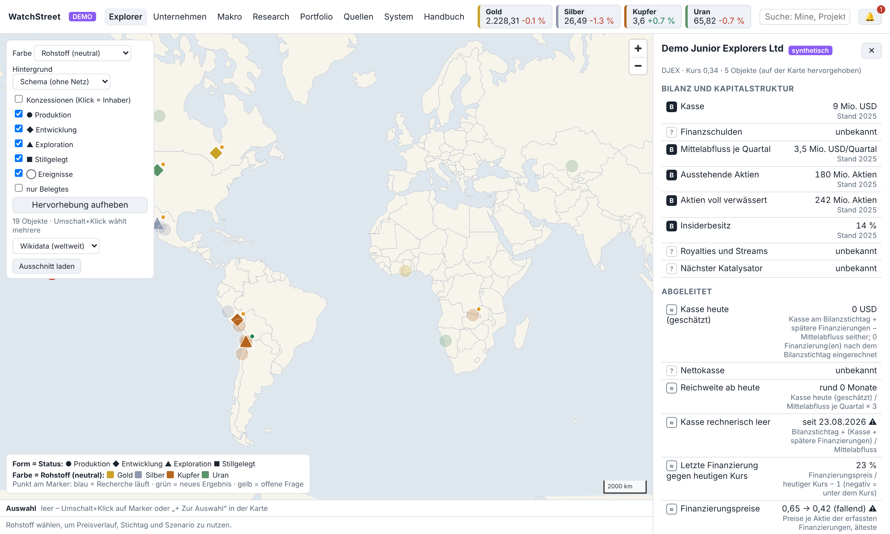

Reicht die geschätzte Kasse ab heute weniger als zwölf Monate, legt die Regelprüfung eine
Auffälligkeit und einen Recherchevorschlag zur Finanzierung an. „Belegt“ im Prüfkatalog heisst, dass etwas vorliegt, nicht,
dass die Antwort gut ist. Asset-NAV und das Verhältnis dazu sind einfache Modellrechnungen, keine
Bewertung.

Ist eine These aktiv, lässt sich im Herleitungsdialog jede Kennzahl der These als stützende oder
widersprechende Evidenz zuordnen.

**Wie viel Geld ist heute noch da?** Die Bilanz ist immer alt. „Kasse heute (geschätzt)“ rechnet
deshalb vom Bilanzstichtag weiter: Kasse plus später erfasste Finanzierungen minus Mittelabfluss seither.
Alle abgeleiteten Werte – Nettokasse, Reichweite ab heute, Unternehmenswert, Finanzierungslücke –
stehen auf dieser einen Basis; Börsenwert und Verwässerungsüberhang rechnen mit den Aktien inklusive
später ausgegebener Aktien und Warrants. Darunter steht „Kasse rechnerisch leer am …“ oder, wenn das
Datum schon vorbei ist, „seit …“ mit Warnzeichen. Die berichteten Kennzahlen oben bleiben unverändert
auf dem Bilanzstichtag, und der Bilanzstichtag steht jeweils mit vollem Datum darunter („Kasse 9 Mio.,
Bilanzstichtag 31.12.2025“ neben „Kasse heute (geschätzt)“). Alle Reichweiten – auch die Auffälligkeit
der Regelprüfung – rechnen ab der geschätzten Kasse von heute, nie ab der Bilanz.

**Kasse rechnerisch aufgebraucht:** Erreicht die Schätzung null, steht dort keine nackte „0“. „Kasse
heute (geschätzt)“ und „Reichweite ab heute“ lauten dann „rechnerisch aufgebraucht seit …“, mit dem
Hinweis „Bilanz vom … ist älter als die Reichweite – vermutlich fehlt eine Finanzierung“. Gemeint ist:
Das Unternehmen hat seit der Bilanz sehr wahrscheinlich Geld aufgenommen, das hier nicht erfasst ist.
Trage die Finanzierung unter „Finanzierungen“ ein oder lege eine neuere Bilanz an, dann rechnet die
Seite wieder mit einer positiven Kasse. In der Tabelle der Unternehmen steht dafür „aufgebraucht“ und
„⚠ Bilanz zu alt“. Abgeleitete Werte sind gerundet („rund 8 Monate“): Sie sind grob, und
Nachkommastellen würden etwas anderes vortäuschen. Bei einem Stichtag in der Vergangenheit werden kein
Kurs und keine späteren Finanzierungen gezeigt.

**Finanzierungslücke und Unternehmenswert:** Unter „Abgeleitet“ stehen zusätzlich der Unternehmenswert
(Börsenwert + Finanzschulden − Kasse), der anteilige Capex der noch nicht produzierenden Projekte und
die Finanzierungslücke (Capex − Kasse, mindestens 0). Die Lücke zeigt, wie viel Kapital noch beschafft
werden muss – in aller Regel über neue Aktien. Personen und Finanzierungen lassen sich unter „Person
erfassen“ und „Finanzierung erfassen“ selbst eintragen; sie gelten als eigene Angabe ohne Quelle.
Eine Finanzierung braucht Datum (nicht in der Zukunft), Art und Betrag. Zusätzlich stehen der Börsenwert
voll verwässert und die Finanzierungslücke als Vielfaches des Börsenwerts in der Liste. Die Summe der
Asset-NAV nennt, aus wie vielen der produzierenden Objekte sie gebildet ist.

Eine **angekündigte** Finanzierung (Haken „nur angekündigt“) darf in der Zukunft liegen. Sie wird als
Was-wäre-wenn eingerechnet – Kasse, Aktienzahl, Überhang, Reichweite – und die Formel nennt, wie viele
der eingerechneten Finanzierungen nur angekündigt sind. „Letzte Finanzierung gegen heutigen Kurs“ zeigt
den Abschlag, „Finanzierungspreise“ die Folge der Preise; fallende Preise sind markiert.

Finanzierungen nehmen auch Warrants (Stück, Ausübungspreis, Laufzeit) und Zeichner auf. Liegt eine
Finanzierung nach dem Bilanzstichtag, erscheint zusätzlich „Aktien heute“, und alle abgeleiteten Werte
rechnen sie ein. Für Projekte stehen der NPV laut Studien (anteilig)
und das Verhältnis Börsenwert zu Studien-NPV in der Liste. Bei Personen lassen sich frühere
Unternehmen und der eigene Aktienbesitz erfassen. Eigene Personen und Finanzierungen lassen sich mit
„✕“ löschen. Ein Royalty-Halter erhält einen Wert aus seinem Umsatzanteil über die Reservenlaufzeit.

## 5. Auswahl und Vergleich

„+ Zur Auswahl“ oder `Umschalt+Klick` legt ein Objekt in die Auswahlleiste (höchstens 8). Ausgewählte
Objekte tragen auf der Karte ihre Nummer.

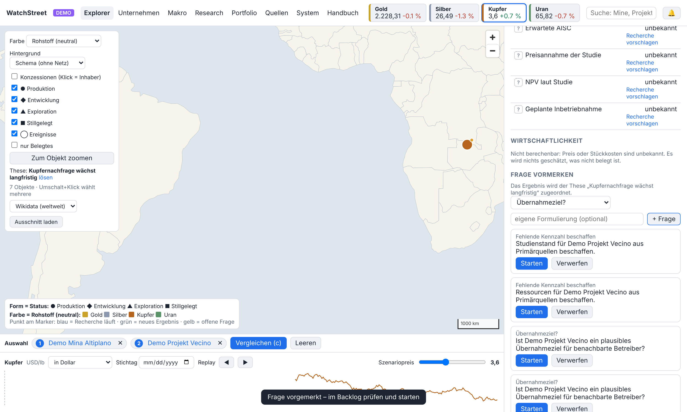

„Vergleichen“ stellt die Karten nebeneinander und zeigt die Lebensläufe ab einem gemeinsamen Anker
(„Jahr 0 = Entdeckung“ usw.). Beruhen Kosten auf unterschiedlichen Definitionen, erscheint ein Hinweis.

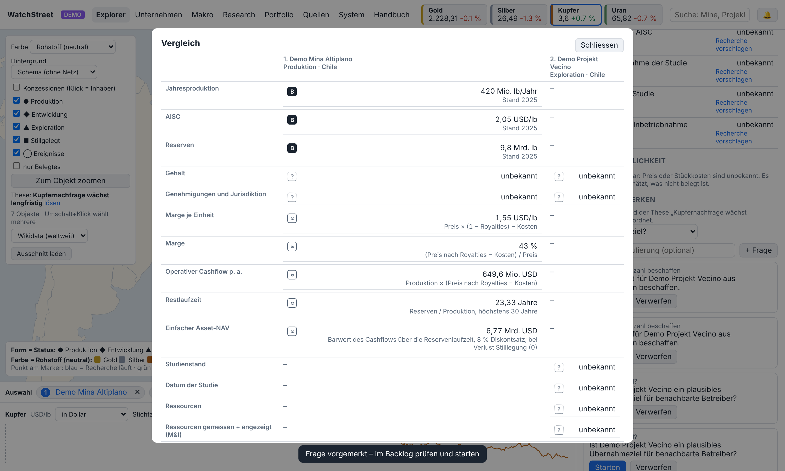

## 6. Fragen vormerken und Recherchen starten

Recherche läuft in zwei bewussten Schritten:

1. **Vormerken:** in der Charakterkarte unter „Frage vormerken“ (Vorlage wählen, optional eigene
   Formulierung) oder bei einer unbekannten Kennzahl über „Recherche vorschlagen“. Auch die
   Analyse-Engine legt Vorschläge an (fehlende Kennzahlen, Kostenausreisser, Nachbarschaft zu Minen
   anderer Betreiber).
2. **Starten:** im Bereich **Research → Backlog** oder direkt in der Charakterkarte. Erst jetzt läuft
   etwas.

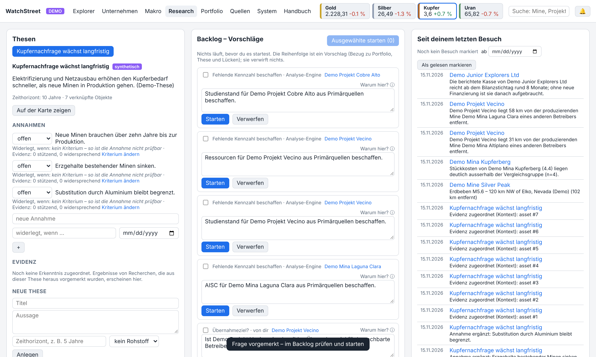

Im Backlog lässt sich der Auftragstext ändern, der Grund für die Reihenfolge einsehen (Maus auf ⓘ),
mehrere Vorschläge gesammelt starten oder ein Vorschlag verwerfen. Die Reihenfolge ist ein Vorschlag.

Während eine Recherche läuft, kann weiter erkundet werden. Fertige Ergebnisse meldet die Glocke; von
dort führt ein Klick zum Objekt.

### Beispiel: fehlende Kosten

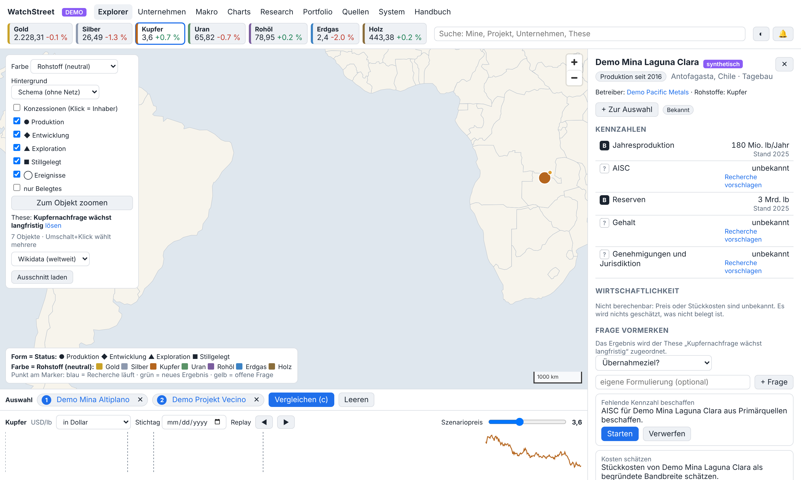

Nach dem Start durchsucht WatchStreet zuerst die gespeicherten Dokumente des Objekts. Wird die Zahl
gefunden, erscheint sie als berichteter Wert mit Zitat; daraus wird die Wirtschaftlichkeit berechnet.

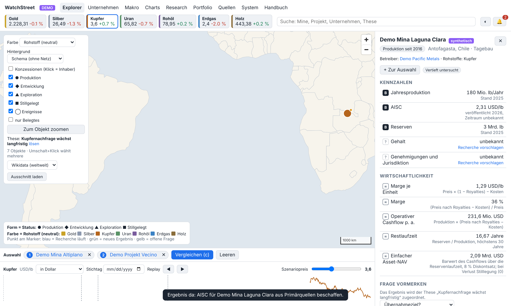
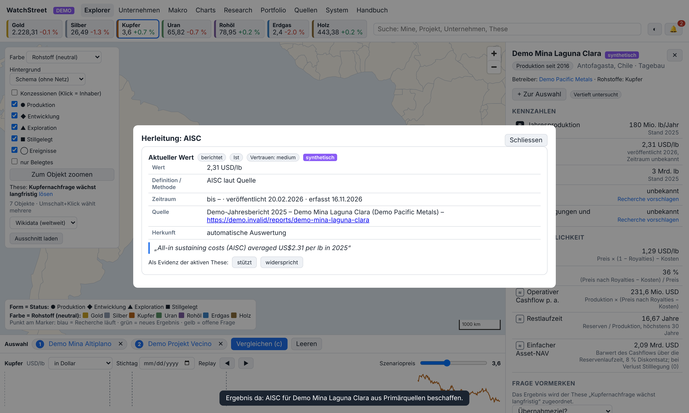

Mögliche Ergebnisse einer Recherche: berichteter Wert mit Zitat, geschätzte Bandbreite mit Methode,
oder ausdrücklich „nicht gefunden“.

### Vorlagen

| Vorlage | Was geschieht |
|---|---|
| Fehlende Kennzahl beschaffen | Suche in gespeicherten Dokumenten, danach (falls konfiguriert) Agent |
| Kosten schätzen | Bandbreite aus belegten Kosten vergleichbarer produzierender Minen (mindestens 3) |
| Übernahmeziel? / Strategische Bedeutung / Kostenstruktur erklären / Freie Frage | Agent bewertet anhand der bekannten Daten und Dokumente. Ohne Agent entsteht nur eine Zusammenstellung, ausdrücklich ohne Bewertung |
| Dokument lesen | siehe Abschnitt 9 |

## 7. Szenario und Stichtag

**Szenario:** Mit dem Regler „Szenariopreis“ in der Zeitleiste ändert sich der angenommene Preis des
gewählten Rohstoffs. Karte und Charakterkarten rechnen neu; ein Banner zeigt den Szenariomodus.
Das Banner nennt, wie viele produzierende Minen bei diesem Preis eine negative Marge haben, welchen
Anteil der Produktion das betrifft und für wie viele Minen Kostendaten fehlen. Die Übersicht rechts
listet die Objekte nach Stückkosten sortiert (niedrigste zuerst) mit ihrer Marge in dieser Ansicht.

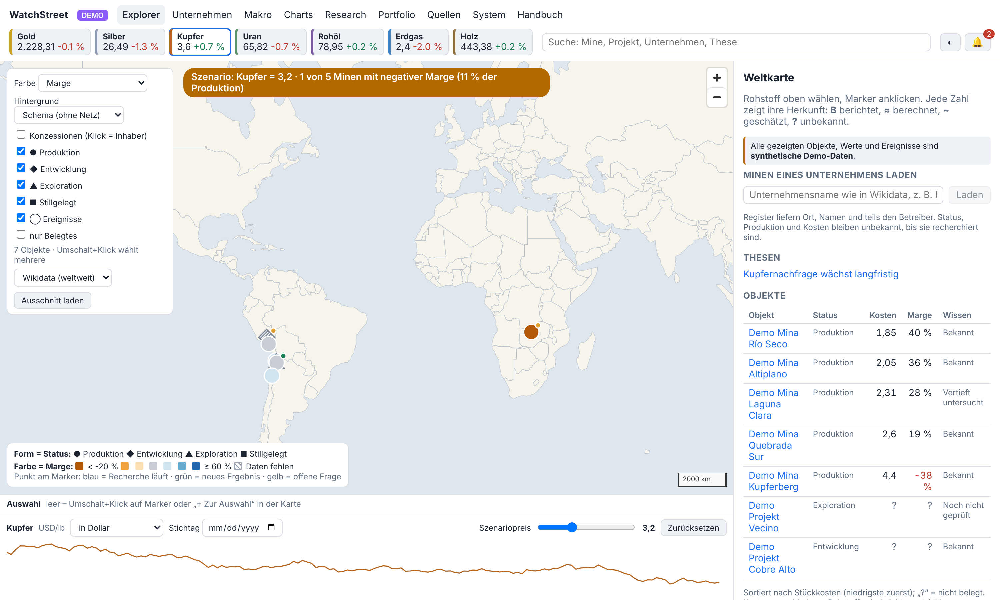

**Stichtag:** Ein Datum im Feld „Stichtag“ oder ein Klick in den Preisverlauf zeigt den damaligen
Stand. Die Auswahl daneben trennt zwei Sichten:

* **wie damals bekannt** – nur, was bis dahin veröffentlicht war. Kennzahlen ohne
  Veröffentlichungsdatum erscheinen hier nicht.
* **rückblickend bekannt** – alles über den Zeitraum, auch später Veröffentlichtes.

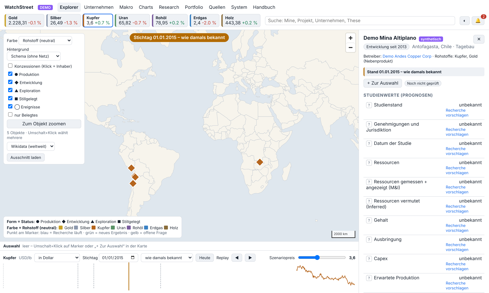

**Replay:** Ist ein Objekt geöffnet, springen ◀ ▶ von Meilenstein zu Meilenstein seines Lebenslaufs;
„ansehen“ im Lebenslauf setzt den Stichtag direkt.

Bei einem Stichtag in der Vergangenheit zeigt die Objektansicht nur, was damals vorlag: keine später
entstandenen Recherchen, Vorschläge oder Quellen, und der Wissensstatus leitet sich allein aus den
damals bekannten Kennzahlen ab.

## 8. Wissensstatus

Der Farbmodus „Wissensstatus“ zeigt je Objekt: noch nicht geprüft, bekannt, vertieft untersucht, neue
Entwicklung, veraltet. Der Status wird abgeleitet und nicht von Hand gepflegt. „Noch nicht geprüft“
heisst, dass nichts vorliegt, nicht, dass nichts existiert.

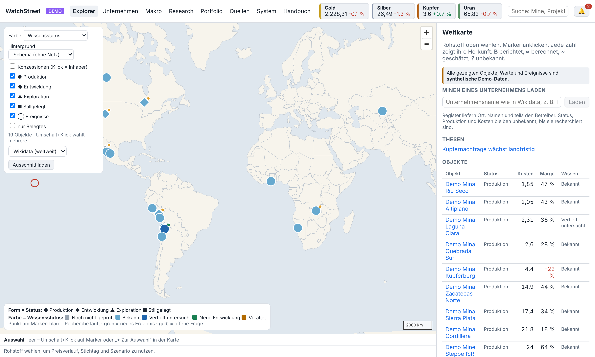

## 9. Research-Bereich

**Thesen:** Aussage, Zeithorizont, Annahmen mit Status (offen, gestützt, widerlegt, unklar) und
zugeordnete Evidenz. Ergebnisse von Fragen, die bei aktiver These vorgemerkt wurden, werden der These
zugeordnet und lassen sich als stützend, widersprechend oder Kontext einordnen.

Eine Annahme ist erst prüfbar, wenn feststeht, woran sie scheitern würde. Darum trägt jede Annahme
ein **Kriterium** („widerlegt, wenn …“) und ein **Prüfdatum**; ist das Datum überschritten, wird sie
als fällig markiert. Wer den Status auf gestützt, widerlegt oder unklar setzt, muss eine
**Begründung** angeben; sie steht bei der Annahme und im Lagebericht. Evidenz lässt sich einer
einzelnen Annahme zuordnen; an jeder Annahme steht, wie viele Belege sie stützen und wie viele ihr
widersprechen. „0 Gegenargumente“ heisst: es wurde noch keines gesucht.

**Recherchen:** Liste aller gestarteten Recherchen. Ein Klick öffnet das Ergebnis mit festen
Abschnitten: Antwort, Unsicherheiten, geprüfte Alternativen, nicht gefunden, abgelehnte Angaben des
Agenten, Folgefragen.

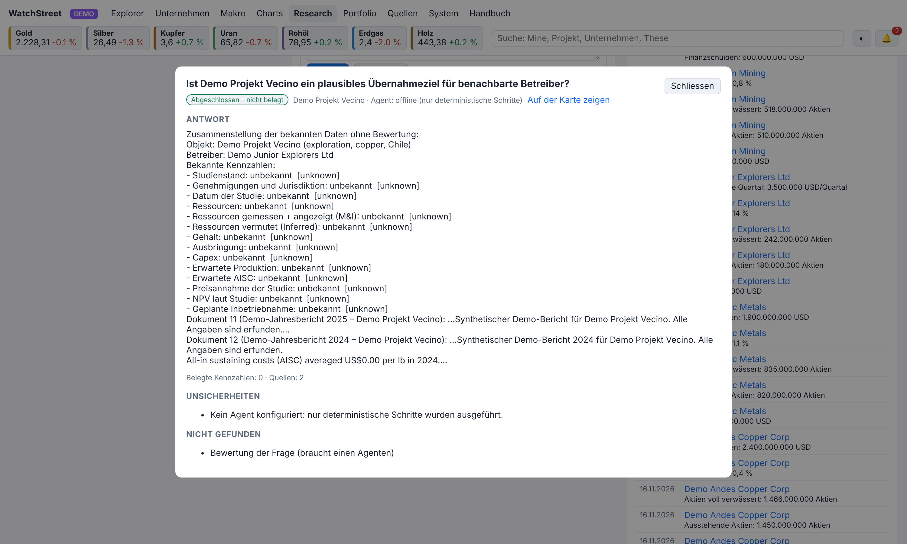

**Seit deinem letzten Besuch:** alle Änderungen (neue Kennzahlen mit altem und neuem Wert,
abgeschlossene Recherchen, Auffälligkeiten, Ereignisse). „Als gelesen markieren“ setzt den
Besuchszeitpunkt; mit „ab“ lässt sich ein anderes Vergleichsdatum wählen.

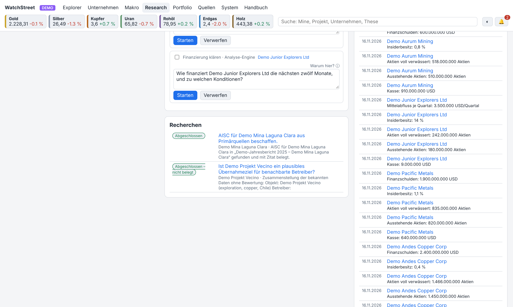

## 10. Portfolio

Bestände und Watchlist. Zu jeder Position gehören drei Angaben, die eine Entscheidung später
überprüfbar machen: die **These**, auf der sie beruht, die **Absicht** (warum du kaufst) und die
**Ausstiegsbedingung** (was eintreten müsste, damit du verkaufst). Fehlt eine davon, steht ein
Warnzeichen an der Position. Ein Kauf lässt sich nur mit Absicht und Ausstiegsbedingung erfassen.

Das **Entscheidungsprotokoll** hält jeden Kauf, jede Änderung der Ausstiegsbedingung und jeden Verkauf
fest, mit Begründung und dem damaligen Wissensstand: Kurs, Status der Annahmen der These und die
Unternehmenskennzahlen und die Kosten- und Studienwerte der Objekte zu diesem Zeitpunkt, mit dem
Vermerk „ungeprüft“, wo er galt. Änderungen und Verkäufe brauchen eine Begründung; die
alte Ausstiegsbedingung bleibt im Eintrag lesbar. Einträge lassen sich nicht ändern.
Unter „Absicht und Bezug“ steht zu jeder Position das erfasste Unternehmen, seine Objekte (mit Sprung
auf die Karte) und die Thesen, die sich auf das Unternehmen oder seine Objekte stützen. Eine Position
ohne These ist als solche ausgewiesen.

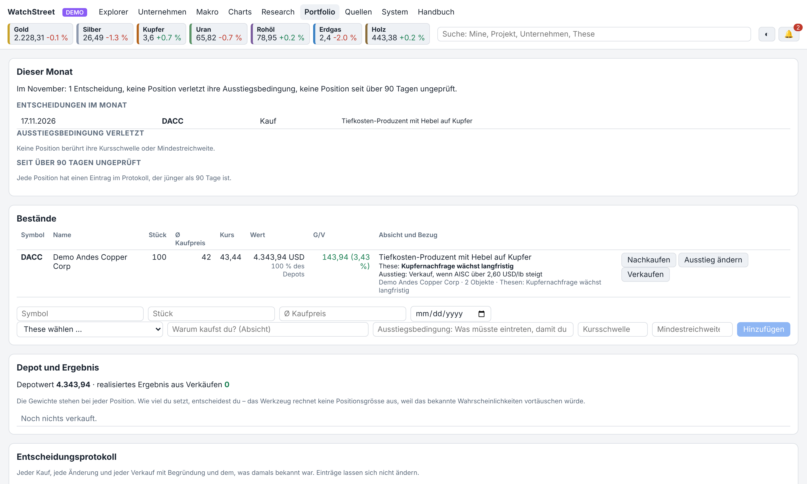

### Depot, Nachkauf, Teilverkauf und Ausstiegsschwellen

* **Depotwert und Gewichte:** Unter jeder Position steht ihr Anteil am Depot. Eine Positionsgrösse
  rechnet WatchStreet bewusst nicht aus.
* **Nachkaufen** und **Verkaufen** (auch teilweise) gehen nur mit Begründung. Beim Verkauf mit Preis
  wird das Ergebnis gegen den Durchschnittskaufpreis festgehalten; „Depot und Ergebnis“ listet alle
  Verkäufe und die Summe.
* **Ausstiegsschwellen:** Zusätzlich zum Text lassen sich eine Kursschwelle und eine Mindestreichweite
  in Monaten setzen. Ist eine Schwelle berührt oder eine Annahme der These widerlegt, steht „⚠ Ausstieg
  prüfen“ an der Position. WatchStreet verkauft nichts; es weist nur darauf hin.

### Dieser Monat

Oben auf der Seite fasst der Kasten **Dieser Monat** den laufenden Kalendermonat zusammen, nur aus
dem gespeicherten Entscheidungsprotokoll und den Beständen; nichts davon wird gespeichert, es wird
bei jedem Öffnen neu berechnet. Er zeigt einen Satz vorweg, dann drei Teile:

* **Entscheidungen im Monat:** jeder Kauf, jede Änderung und jeder Verkauf dieses Kalendermonats mit
  Datum, Symbol, Art und Begründung.
* **Ausstiegsbedingung verletzt:** Positionen, deren Kursschwelle erreicht oder unterschritten ist
  oder deren Reichweite unter der Mindestreichweite liegt – dieselben Prüfungen wie das Warnzeichen
  an der Position. Fehlt ein Kurs, gilt die Position nicht als verletzt. Der Freitext der
  Ausstiegsbedingung wird nicht ausgewertet, weil WatchStreet ihn nicht prüfen kann.
* **Seit über 90 Tagen ungeprüft:** Positionen, zu denen seit mehr als 90 Tagen kein Eintrag im
  Protokoll steht (Kauf, Nachkauf, Änderung oder Verkauf). Das ist eine Erinnerung, keine Regel: Die
  Zusammenfassung verkauft nichts und bewertet nichts neu.

## 10a. Unternehmen sichten

Die Seite „Unternehmen“ zeigt alle erfassten Unternehmen in einer Tabelle: Kasse heute (geschätzt),
Reichweite, Börsenwert, Verwässerungsüberhang, Finanzierungslücke, Datum „Kasse leer“, nächster Termin
und wie viele der zehn Prüffragen beantwortet sind. Ein Klick auf eine Spalte sortiert, ein Klick auf den
Namen öffnet die Unternehmensansicht. Eine Reichweite unter zwölf Monaten ist rot. Unternehmen mit
ungeprüften importierten Zahlen sind markiert.

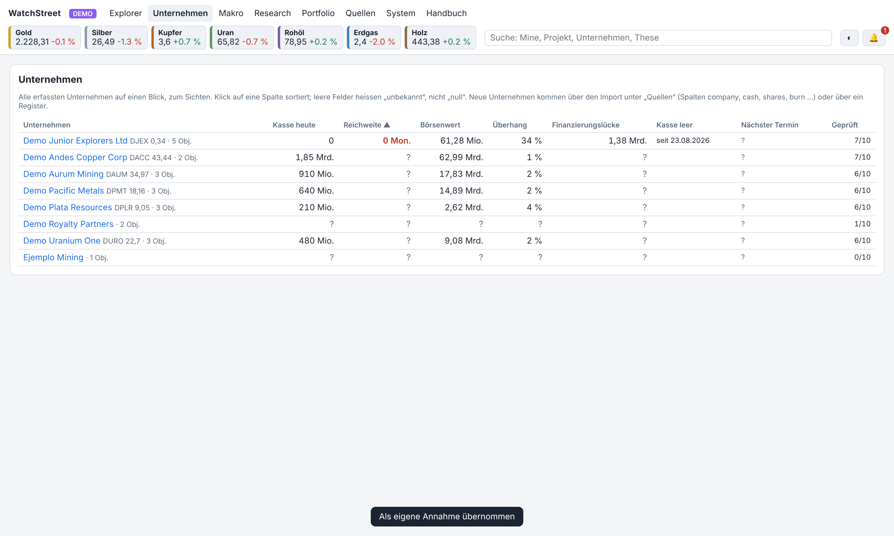

Auf dem Handy ordnen sich Kopfzeile, Karte und Ansichten untereinander an; breite Tabellen lassen sich
seitlich schieben.

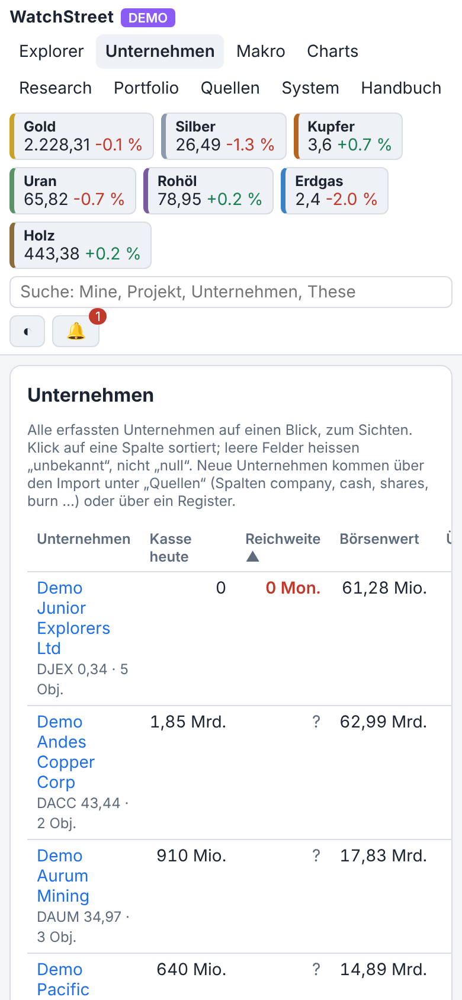

## 10b. Makro

Der Bereich **Makro** verfolgt das Umfeld, in dem Rohstoffe und Minenaktien bewertet werden. Die
Reihen stammen aus der Datenbank FRED der Federal Reserve Bank of St. Louis; der Hintergrunddienst
holt sie mit jedem Lauf, „Jetzt aktualisieren“ fordert einen Lauf an.

| Gruppe | Inhalt |
|---|---|
| Liquidität | Bilanzsumme der Fed, Konto des Finanzministeriums (TGA), Reverse Repo, Geldmenge M2 mit Jahresrate, Nettoliquidität |
| Zinsen | Leitzins, Staatsanleihen 2 und 10 Jahre, Realzins 10 Jahre, Inflationserwartung, Zinskurve 10 − 2 Jahre |
| Inflation | Verbraucherpreisindex und Jahresrate |
| Dollar und Währungen | breiter Dollar-Index (handelsgewichtet, nicht der DXY), Euro, Kanadischer und Australischer Dollar |
| Risiko | VIX |
| Bau und Wohnen (Holznachfrage) | Baubeginne für Wohnungen in den USA, Hypothekenzins 30 Jahre |
| Märkte und Rohstoffe | S&P 500, Rohöl (WTI), Erdgas (Henry Hub), Gold, Silber, Kupfer, Uran, Rohöl-, Erdgas- und Holz-Terminkontrakt |
| Verhältnisse | Gold ÷ Silber, Kupfer ÷ Gold, Uran ÷ Gold, S&P 500 ÷ Gold, Rohöl ÷ Gold, Holz ÷ Gold |

Jede Kachel zeigt den letzten Wert, den Tag der Beobachtung, die Frequenz und die Veränderung in
einem Jahr. Ein Klick öffnet den grossen Chart: Zeitraum wählen, logarithmische Skala, mit der Maus
Tag und Wert ablesen.

**Makro im Demo-Modus:** Die Reihen sind echte FRED-Daten ab 2003 (Stand des Snapshots: 16.11.2026),
als Datei im Programm mitgeliefert; der Demo-Modus ruft FRED nicht ab. Die Quelle ist die Federal
Reserve Bank of St. Louis (FRED); die einzelnen Reihen gehören ihren Herausgebern, deren Namen auf
der jeweiligen Seite von fred.stlouisfed.org stehen. Der Stand endet mit den letzten Veröffentlichungen
je Reihe, also nicht heute: Tägliche und wöchentliche Reihen reichen bis wenige Tage vor dem Stand,
Geldmenge M2 und Baubeginne bis September 2026, CPI bis Oktober 2026. Die Kurse von
Rohstoffen und Aktien im Demo-Modus sind dagegen synthetisch und laufen bis heute. Echt sind
dagegen die langen Monatsreihen für Gold (Weltbank, Pink Sheet, über das gemeinfreie Datenpaket
`datasets/gold-prices`), Kupfer und Uran (IMF, über FRED), der Minenindex XAU und der Stundenlohn;
sie speisen die Sicht „Kaufkraft“ (Abschnitt 10c). Den Snapshot erneuert man von Hand mit
`python scripts/snapshot_macro_history.py`.

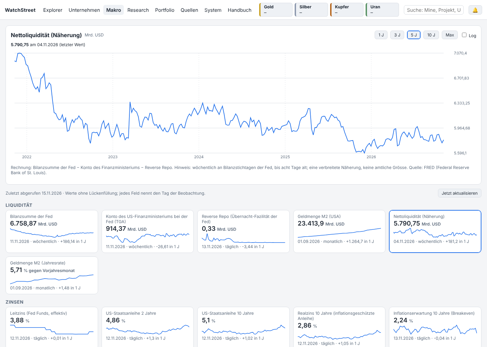

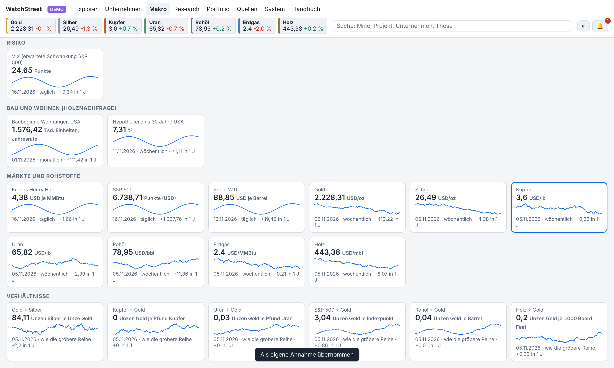

**Rechenregeln (es wird nichts aufgefüllt oder geschätzt):**

* **Nettoliquidität** = Bilanzsumme der Fed − Konto des Finanzministeriums − Reverse Repo, nur an
  Bilanzstichtagen (Mittwoch) und nur, wenn alle drei Reihen an diesem Tag einen Wert haben. Fällt
  ein Mittwoch auf einen Feiertag, fehlt die Woche. Es ist eine verbreitete Näherung, keine amtliche
  Grösse.
* **Verhältnisse und „in Gold“** entstehen nur an Tagen, an denen beide Reihen einen eigenen Wert
  haben. Die Auflösung ist die der gröberen Reihe (Rohstoffpreise liegen wöchentlich vor).
* **Inflationsbereinigt** heisst: Monatsmittel des Preises, umgerechnet in Kaufkraft des letzten
  veröffentlichten CPI-Monats. Der Chart endet mit diesem Monat; fehlt ein CPI-Monat, fehlt der
  Punkt.
* **Gemessen in:** Preise (Rohstoffe, S&P 500, Öl) lassen sich über drei Knöpfe unter der
  Überschrift zeigen – in Dollar, in Unzen Gold oder inflationsbereinigt; der aktive Knopf ist
  hervorgehoben. Es ist derselbe Preis, nur in einer anderen Einheit gemessen. Steigt der Kurs in
  Gold nicht, obwohl er in Dollar steigt, ist der Dollar weniger wert geworden, nicht der Preis
  gestiegen. Bei Reihen, die kein Preis sind (Zinsen, Bilanzsummen, Verhältnisse), fehlen die Knöpfe;
  stattdessen steht „Diese Reihe ist kein Preis und lässt sich nicht umrechnen.“ Darunter steht für
  ein und fünf Jahre die Zerlegung „Änderung in Dollar = Goldpreis × Änderung in Gold gemessen“. Das
  ist eine Rechnung, keine Ursachenaussage. Derselbe Umschalter steht im Explorer am Preisverlauf des
  gewählten Rohstoffs; Szenario und Karte rechnen weiter in Dollar.
* **Entscheidungsprotokoll:** Jeder Kauf und Verkauf hält Realzins, Rendite 10 Jahre, Leitzins,
  Dollar-Index, VIX, Nettoliquidität und Inflationsrate mit ihrem Beobachtungstag fest.

## 10c. Charts

Der Bereich „Charts“ zeigt Preise nicht als eine Linie, sondern in sechs Sichten. Alles ist Rechnung
auf gespeicherten Werten: keine Prognose, kein Signal, keine Lückenfüllung. Einzige Schätzung ist
die Empfindlichkeit in der Treiberleiter; sie ist als solche beschriftet. Die Anwendung speichert
dafür Wochenschlusskurse aller Aktien, die im Depot, auf der Beobachtungsliste oder an einem
Unternehmen hängen.

**In einfachen Worten.** Jede Sicht beginnt mit ein bis zwei Sätzen, die aus den tatsächlichen
Zahlen gebaut sind, zum Beispiel: „Stieg Realzins um 1 Prozentpunkt, dann fiel Gold in diesem
Zeitraum im Schnitt um 6 %. Das erklärt 31 % der Bewegung.“ Die Sätze sagen nur, was die Zahlen
tragen: fehlen Daten, steht das da; erklärt ein Zusammenhang weniger als 10 % der Bewegung oder
ist die Steigung nicht belastbar, heisst es „Der Zusammenhang ist schwach – nicht als Regel
verwenden“. Sie enthalten nie eine Kauf- oder Verkaufsempfehlung. Unter jeder Sicht klappt
„Was heisst das?“ eine kurze Erklärung jeder Zahl und jeder Spalte auf.

**Treiberleiter** – zeigt jeden Wert gegen das, was hinter ihm steht: die Aktie gegen ihren
Rohstoff, den Rohstoff gegen Realzins und Dollar, diese gegen Inflation und Liquidität, die
Inflation gegen Energie. Welche Treiber hinter einer Reihe stehen, ist eine hinterlegte Annahme
(`DRIVERS` in `services/charts.py`), kein Befund. Vier Ansichten:

* **Ganze Leiter** – alle Stufen untereinander: letzter Wert, Verlauf, Lage in der Spanne, Änderung
  des letzten Monats und wie ungewöhnlich sie ist (in Standardabweichungen aller Monatsänderungen
  des Zeitraums; ab ±2 ist die Stufe markiert). So sieht man, auf welcher Stufe sich gerade etwas
  bewegt. Zwischen den Stufen steht die geschätzte Empfindlichkeit.

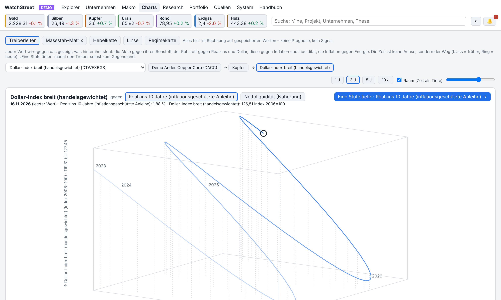

* **Weg** – der Wert gegen seinen Treiber; die Zeit ist keine Achse, sondern der Weg (blass =
  früher, Ring = heute). „Raum“ stellt die Zeit als dritte Achse dar: mit der Maus ziehen dreht die
  Ansicht, Doppelklick stellt sie zurück; der Würfel wird bei jedem Winkel neu in den Rahmen
  eingepasst, die graue Linie am Boden ist der Schatten des Wegs. „Eine Stufe tiefer“ macht den
  Treiber selbst zum Gegenstand; die Spur oben führt zurück.

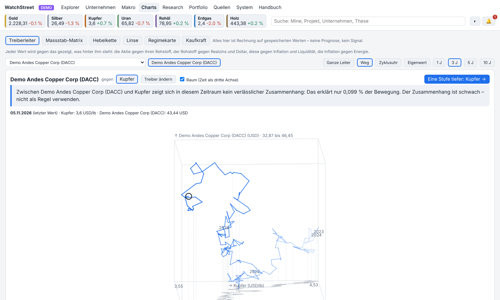

* **Zyklusuhr** – der Winkel ist die Phase des Treibers (rechts hoch, links tief, oben steigend,
  unten fallend), der Abstand vom Mittelpunkt der Wert des Gegenstands. Zeiträume in derselben
  Phase liegen auf demselben Strahl übereinander. Daneben stehen die früheren Zeiträume in der
  heutigen Phase mit der Änderung des Gegenstands *während* dieser Zeit. „Hoch“ und „tief“ beziehen
  sich auf den Durchschnitt des gezeigten Zeitraums: Rückschau, keine Prognose.

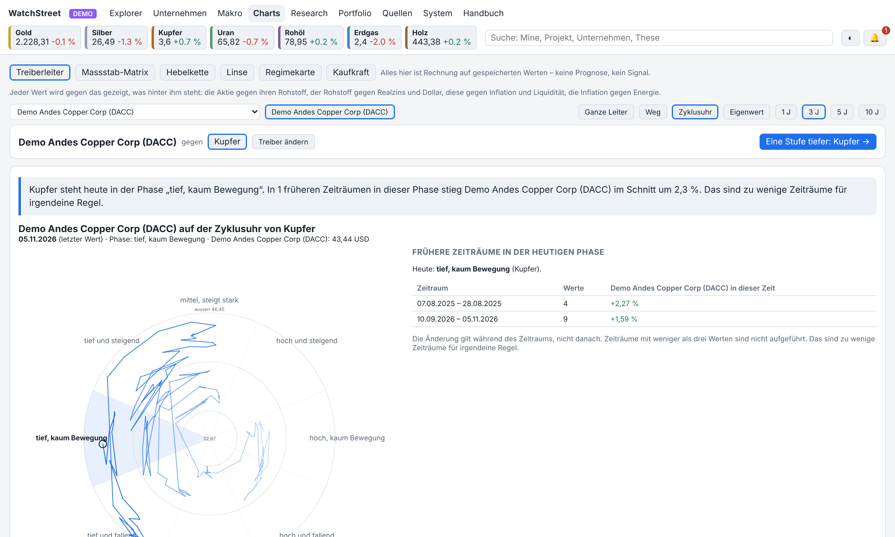

* **Eigenwert** – trennt, was der Treiber an der Kursänderung erklärt, von dem, was der Wert selbst
  beigetragen hat. An jedem Tag gilt: erklärt = Änderung des Treibers × Empfindlichkeit, wobei die
  Empfindlichkeit nur aus früheren Änderungen geschätzt ist; der Rest ist der eigene Anteil. Beide
  addieren sich zur Gesamtänderung. Bei einer Minenaktie gegen ihren Rohstoff ist der eigene Anteil
  das, was am Unternehmen selbst liegt – als Schätzung, nicht als Bewertung.

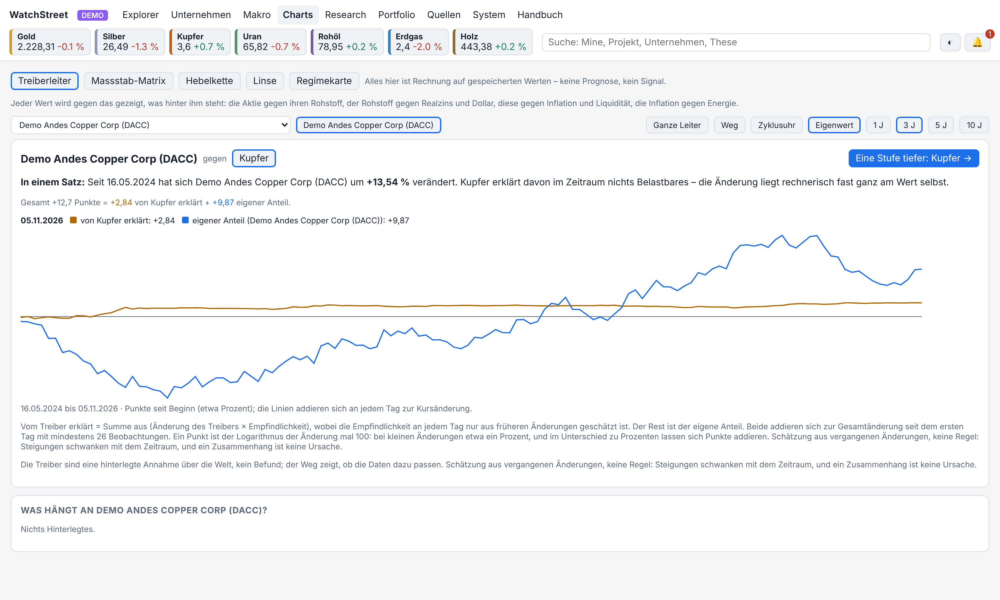

**Mehrere Treiber.** Hinter einem Wert steht oft mehr als eine Grösse (Kupfer: Dollar *und*
Realzins). Hat eine Reihe zwei oder drei Treiber, rechnet die Leiter zusätzlich alle zugleich
(„gemeinsame Schätzung“, kleinste Quadrate mit allen Treibern auf einmal) und zeigt eine Tabelle:
je Treiber die Empfindlichkeit und den **Beitrag im Zeitraum** (Empfindlichkeit mal Bewegung des
Treibers, in Punkten), dazu den **Eigenanteil** – den Rest, den der Wert selbst mitbrachte – und
„erklärt x % der Bewegung (R²)“. Beiträge und Eigenanteil addieren sich genau zur Gesamtänderung.
Gerechnet wird auf dem gröbsten Takt aller beteiligten Reihen (siehe Linse). Bewegen sich zwei
Treiber fast gleich (z. B. zwei Zinsen), lassen sich ihre Anteile nicht trennen; die Anwendung
zeigt dann keine Tabelle, sondern sagt das. Welche Ansicht gilt: Ohne Auswahl rechnet die Leiter
mit der hinterlegten bzw. eigenen Treiberliste des Werts; wählst du in der Kopfzeile einen
einzelnen Treiber an, zeigt sie die Einzelschätzung dieses Treibers, behält aber die
gemeinsame Tabelle der ganzen Liste. Die Einzelschätzungen (Weg, Eigenwert, Zyklusuhr) bleiben
unverändert.

**Eigene Treiberliste.** Die Treiber in der Kopfzeile sind Chips. „Treiber ändern“ öffnet einen
kleinen Editor: Treiber entfernen (×), aus der Auswahl hinzufügen (höchstens drei, keiner doppelt,
nicht der Wert selbst), „Speichern“. Die Liste gilt für diesen Wert, auch für „Ganze Leiter“,
Zyklusuhr und die Spalte „Was hängt an …“, und ist als „eigene Auswahl“ markiert. „Zurück zum
Standard“ löscht sie und stellt die hinterlegten Treiber wieder her. Sie ist weiter deine Annahme
über die Welt, kein Befund. Für Skripte: `GET`, `PUT` (Body `{"drivers": ["gold", "DFII10"]}`) und
`DELETE` auf `/api/v1/charts/drivers/{Schlüssel}`; die Leiter nimmt ausserdem
`/api/v1/charts/ladder?key=…&drivers=a,b,c`.

Ist eine Empfindlichkeit grau („kein belastbarer Zusammenhang im Zeitraum“), lässt sich die Steigung
nicht von null unterscheiden (t-Wert unter 2) oder sie wechselt zwischen den Hälften das Vorzeichen.
Bei Jahresraten von Monatsdaten überlappen die Beobachtungen; die Anwendung weist darauf hin, dass
Anzahl und t-Wert dort überschätzt sind.

Unter Weg, Zyklusuhr und Eigenwert steht, was am betrachteten Wert hängt, mit der geschätzten
Empfindlichkeit (Steigung der Änderungen), dem erklärten Anteil, der Zahl der Beobachtungen und der
Steigung in beiden Hälften des Zeitraums.

**Massstab-Matrix** – Zeilen sind Aktien und Rohstoffe, Spalten die Massstäbe US-Dollar, Gold,
Verbraucherpreise, Geldmenge M2 und Rohöl. Jede Zelle zeigt den Verlauf über bis zu zehn Jahre, die
Änderung über ein Jahr und als Strich die Lage des heutigen Werts in der eigenen Spanne. Ein Klick
auf eine Zelle vergrössert sie; ein Klick auf den Namen öffnet die Hebelkette. Jede Zelle hat ihre
eigene Skala: vergleichbar sind die Prozentzahlen, nicht die Formen.

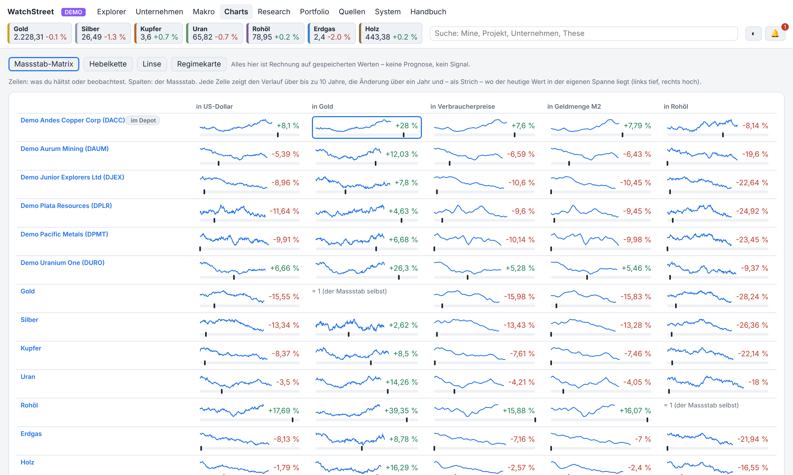

**Hebelkette** – zerlegt die Kursänderung in Glieder, die sich zum Kurs multiplizieren: Währung
(nur bei Aktien ausserhalb des Dollars), Goldpreis, Rohstoff gemessen in Gold, Unternehmen gemessen
im Rohstoff. Die Beiträge sind Punkte (Logarithmus der Änderung mal 100, bei kleinen Änderungen etwa Prozent) und addieren sich exakt zur Gesamtänderung; der
untere Chart zeigt, wann welcher Beitrag kam. Das ist Buchhaltung, keine Ursachenaussage: „gemessen
in“, nicht „wegen“. Der Rohstoff ist der häufigste Hauptrohstoff der Objekte des Unternehmens.

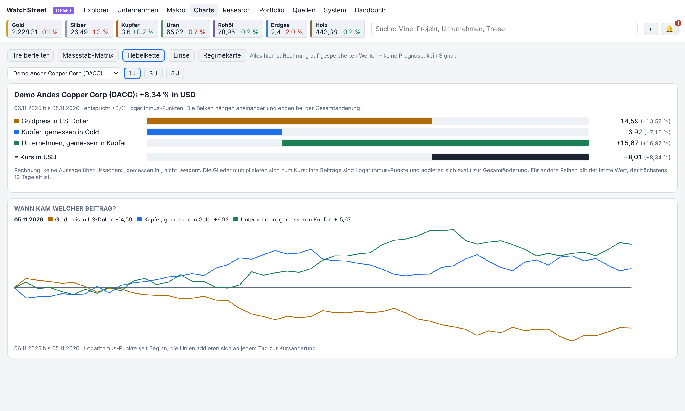

**Linse** – eine Formel über Reihen, die sich speichern lässt. `$objekt` steht für das gewählte
Objekt, sodass dieselbe Linse auf jede Aktie und jeden Preis passt.

| Schreibweise | Bedeutung |
|---|---|
| `$objekt / gold` | Objekt in Unzen Gold |
| `copper / gold`, `DGS10 - DGS2` | Verhältnis oder Differenz zweier Reihen (Schlüssel stehen in der Auswahl in eckigen Klammern) |
| `ma(x, n)` | Mittel über n Beobachtungen |
| `lag(x, n)`, `chg(x, n)` | Wert bzw. Änderung in % gegenüber n Beobachtungen zuvor |
| `yoy(x)` | Änderung in % gegenüber dem Wert ein Jahr zuvor |
| `log(x)` | natürlicher Logarithmus |

Die Anwendung rechnet die Einheit mit (Dollar ÷ Dollar je Unze = Unzen) und lehnt Summen
verschiedener Einheiten ab. Zwei Reihen werden nur an Tagen verrechnet, an denen beide einen
eigenen Wert haben; wie viele Beobachtungen dadurch wegfallen, steht unter dem Chart.

**Gemeinsamer Takt.** Mischt eine Formel Reihen verschiedenen Takts (Verbraucherpreise und M2
monatlich, die Bilanz der Fed wöchentlich, Kurse wöchentlich oder täglich), werden *vorher alle*
auf den gröbsten Takt gebracht: Monatsmittel, wenn eine Reihe monatlich ist, sonst
Wochenmittel (Montag der Woche), sonst bleiben die Tage, wie sie sind. Ohne das hätten ein
Tageskurs und ein Monatsindex nur am Monatsersten einen gemeinsamen Tag. Über dem Chart steht ein
Satz, was gerechnet wurde, z. B. „Gerechnet auf Monatsmitteln, weil „Geldmenge M2“ nur monatlich
erscheint.“; im Ergebnis der API steht der Takt als `grid` („monthly“, „weekly“, „daily“). Eine
einzelne Reihe behält ihre eigenen Tage. Für Preis ÷ Verbraucherpreise oder M2 gibt es ausserdem
die Matrix-Spalten.

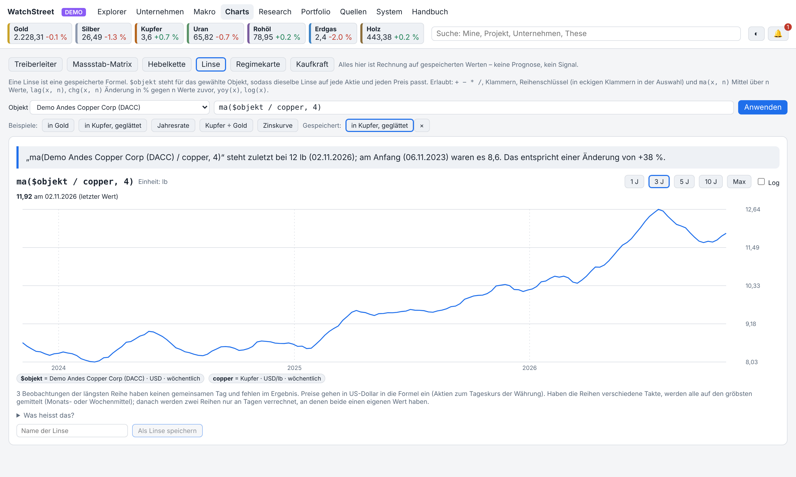

**Regimekarte** – eine Ebene aus zwei Makrogrössen (voreingestellt Realzins × Dollar-Index). Die
Linie ist der Weg der Welt durch diese Ebene, blass am Anfang, kräftig am Ende, der Ring ist heute.
Käufe (▲ grün), Verkäufe (▽) und Anpassungen (▲ gelb) aus dem Entscheidungsprotokoll liegen an der
Stelle, an der die Welt an dem Tag stand. Die Karte färbt nichts nach späterer Rendite und sagt
nichts über die Zukunft.

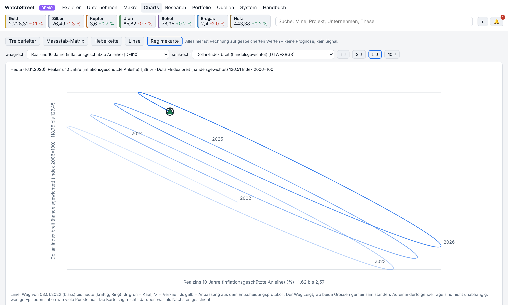

**Kaufkraft** – zeigt einen Wert über die Zeit, gemessen an fünf Dingen, die man dafür kaufen
könnte: einem **Warenkorb** (Verbraucherpreise USA), einer **Arbeitsstunde** (Stundenlohn von
Arbeitern), einem Anteil an der **Geldmenge** M2, einer Unze **Gold** und einem Barrel **Öl**. In
einem Satz: *Liegt das ganze graue Band über der Nulllinie, hat der Wert an Kaufkraft gewonnen,
egal womit man misst; schneidet es die Null, hängt das Urteil am Massstab.*

Warum fünf und nicht einer? Jeder Massstab hat einen bekannten Fehler: Der Warenkorb ist umstritten
(Qualitätsbereinigung, Mieten), Löhne steigen mit der Produktivität schneller als Preise, die
Geldmenge wächst auch mit der Wirtschaft, Gold hat ein eigenes Regime (Realzins, Angst, Käufe der
Notenbanken), Öl schwankt kurzfristig am stärksten. Die Ansicht erklärt keinen davon zum richtigen,
sondern zeigt, wo sie sich einig sind. Der Dollar steckt in keiner Linie: Wert und Massstab sind
beide in Dollar notiert, beim Teilen kürzt er sich heraus. Wer „US-Dollar (Bargeld)“ wählt, sieht
das Band der Massstäbe selbst – seit 2003 hat der Dollar nach allen fünf an Kaufkraft verloren
(zwischen −46 % im Warenkorb und −92 % in Gold).

* **Linien und Band** – jede farbige Linie ist die Änderung in einem Massstab, die dicke Linie die
  Mitte (Median). Das dunkle Band reicht vom zweitniedrigsten bis zum zweithöchsten Massstab, das
  helle vom niedrigsten bis zum höchsten. Die Skala ist logarithmisch (+100 % und −50 % liegen
  gleich weit von der Null). Wie breit das Band ist, hängt nicht vom Wert ab, nur von den
  Massstäben untereinander.
* **Streifen** – darunter steht für jeden Monat, ob alle Massstäbe einen Gewinn zeigen (dunkelgrün),
  die Mehrheit (hellgrün), keine Mehrheit (grau), die Mehrheit einen Verlust (hellrot) oder alle
  (dunkelrot). Änderungen unter einem Prozent zählen als unverändert.
* **seit Ausgangsmonat / je 12 Monate** – die Änderung seit dem ersten Monat oder gegenüber dem
  Vorjahresmonat. Den Ausgangsmonat setzt die Auswahl „ab“ oder ein Klick in den Chart.
* **Tabelle** – je Massstab die Änderung, in wie vielen Monaten er allein gegen alle anderen stand,
  und was man über ihn wissen muss. Ist der Wert selbst ein Massstab (Gold, Öl), fällt dieser weg.

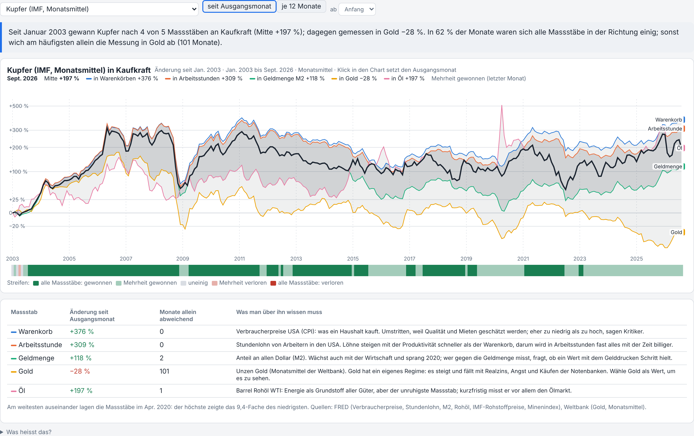

Beispiele aus den echten Daten: Kupfer hat seit Januar 2003 nach vier von fünf Massstäben an
Kaufkraft gewonnen, nur gemessen in Gold verloren – und Gold war in 101 Monaten der einzige
Abweichler. Die Gold- und Silberminen (Index XAU) liegen seit 2004 im Warenkorb vorn, in Gold aber
rund 60 % hinten; von 2013 bis 2019 lagen sie, ab 2004 gerechnet, nach allen fünf Massstäben im
Minus.

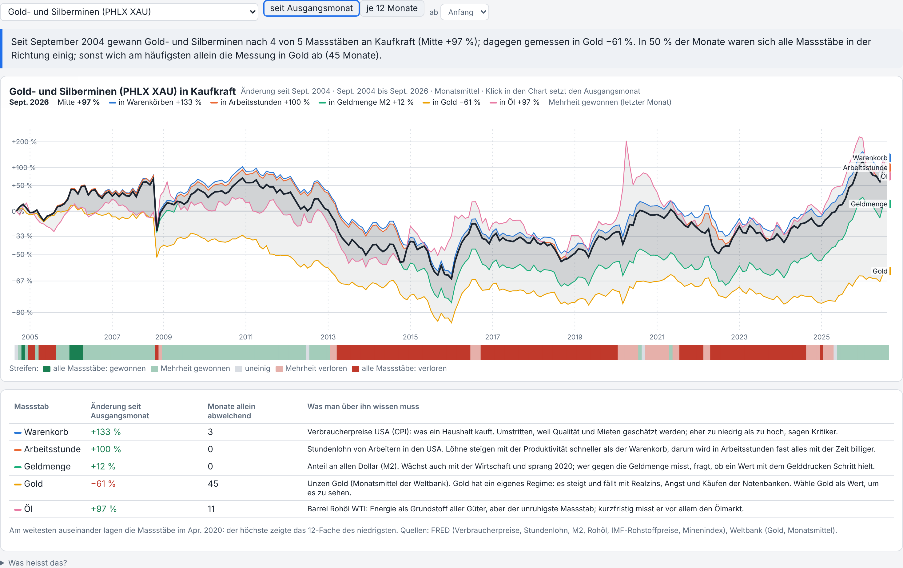

In „je 12 Monate“ zeigt Gold die bekannten Episoden: Ende 2008 hielt es seine Kaufkraft (Mitte 0 %),
während Kupfer und Öl mehr als die Hälfte verloren; in den zwölf Monaten bis August 2011 gewann es
nach allen Massstäben zwischen 28 und 42 %; im Inflationsjahr 2022 (zwölf Monate bis Dezember)
verlor es gegen Warenkorb und Löhne 5 bis 6 %, gegen die Geldmenge nichts, weil M2 schrumpfte.

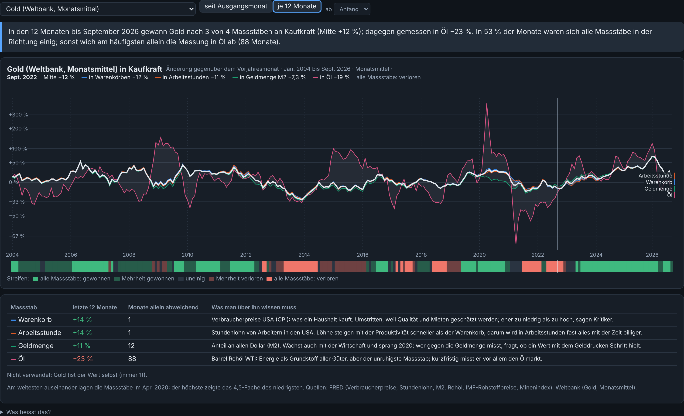

**Daten.** Gerechnet wird auf Monatsmitteln, ein Monat zählt nur, wenn der Wert und alle Massstäbe
einen eigenen Wert haben; deshalb endet das Band mit der spätesten gemeinsamen Veröffentlichung
(meist M2, gut einen Monat alt). Die Massstäbe und die langen Rohstoffreihen sind echte Geschichte
ab 2003: Verbraucherpreise, Stundenlohn, M2, Rohöl, Erdgas, Kupfer und Uran (IMF-Monatsmittel)
und der Minenindex XAU von FRED, Gold als Monatsmittel der Weltbank (Pink Sheet). Für Silber und
Holz gibt es keine frei verfügbare lange Reihe; in der Demo sind diese Kurse und alle Aktienkurse
synthetisch. Die Anwendung markiert solche Werte mit „Demo, synthetisch“ und beginnt den Satz
mit einer Warnung. Rückschau, keine Prognose, kein Signal. Für Skripte:
`/api/v1/charts/purchasing?key=…&mode=since|rolling&start=JJJJ-MM`.

## 11. Quellen

Alle gespeicherten Dokumente. Ein Bericht lässt sich in der Charakterkarte unter „Quellen“ per Adresse
hinzufügen („Dokument lesen“): WatchStreet ruft ihn geschützt ab, speichert den Text und sucht
Kennzahlen darin.

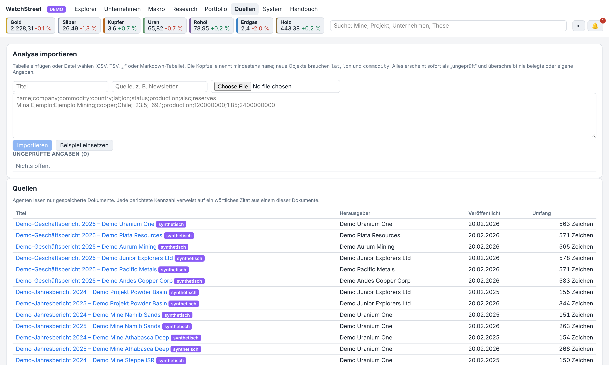

## 11a. Minen aus öffentlichen Registern laden

Ohne Demo-Modus startet die Karte leer. Standorte kommen aus öffentlichen Registern; alles Weitere
wird danach gezielt recherchiert („Lazy Research“).

| Weg | Bedienung | Quelle |
|---|---|---|
| Kartenausschnitt | Karte auf die Region zoomen, links Register wählen, „Ausschnitt laden“ (höchstens 25° Kantenlänge, 300 Einträge je Abruf) | Wikidata (weltweit, nennt teils Betreiber und Eigentümer) oder USGS MRDS (Lagerstättenverzeichnis des US Geological Survey) |
| Unternehmen | in der Übersicht den Unternehmensnamen eingeben, wie er in Wikidata heisst, „Laden“ | Wikidata: Minen, bei denen das Unternehmen als Betreiber oder Eigentümer eingetragen ist |

Der Abruf läuft im Hintergrund; die Glocke meldet das Ergebnis. Übernommen werden nur Einträge zu
Gold, Silber, Kupfer und Uran; bereits vorhandene Objekte werden nicht doppelt angelegt.

Ein Registerobjekt hat Ort, Namen und – falls genannt – Betreiber, jeweils mit dem Registereintrag als
Quelle. **Status, Produktion und Kosten bleiben unbekannt.** In der Charakterkarte führt „Profil
recherchieren“ zu einem Recherchevorschlag; Berichte lassen sich per Adresse hinzufügen. Registerobjekte
erscheinen nicht in Ansichten der Vergangenheit, weil sie keinen datierten Status haben.

Im Demo-Modus ist der Import gesperrt, damit synthetische und echte Daten nie in derselben Datenbank
liegen.

## 11b. Analysen importieren und nach und nach prüfen

Unter „Quellen“ lässt sich eine eigene Analyse oder Liste einfügen oder als Datei hochladen (CSV, TSV,
mit „;“ getrennt oder Markdown-Tabelle). Die Kopfzeile nennt mindestens `name`; ein neues Objekt
braucht zusätzlich `lat`, `lon` und `commodity`. Bekannte Objekte werden über den Namen gefunden.

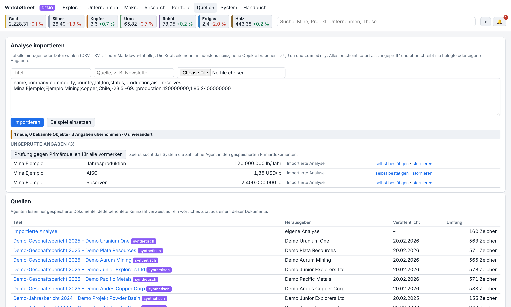

Was der Import bewirkt:

* Objekte und Kennzahlen erscheinen sofort, jede Kennzahl mit dem Hinweis **ungeprüft**.
* Eine importierte Zahl ersetzt nie eine belegte Zahl und nie deinen eigenen Eintrag. Nennt die
  Analyse etwas anderes, steht das als „Abweichung“ im Ergebnis.
* Derselbe Import noch einmal ändert nichts; ein neuer Import mit geänderten Werten ersetzt den alten.

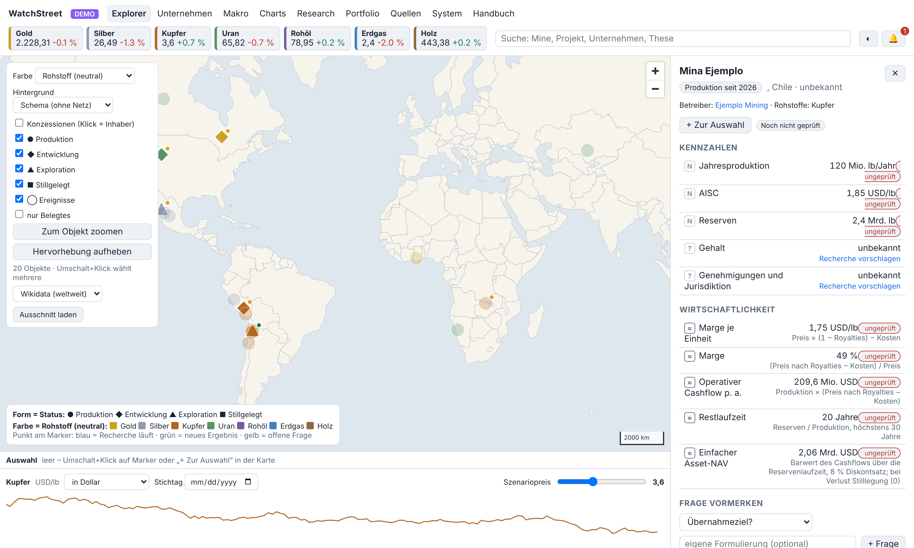

Prüfen lässt sich auf drei Wegen:

1. **Selbst bestätigen** (in der Liste oder in der Herleitung der Zahl): Du gibst an, woher du weisst,
   dass die Angabe stimmt. Sie gilt danach als dein Eintrag, bleibt aber als „eigene Annahme“ markiert
   und behält niedriges Vertrauen – eine Bestätigung ist keine Primärquelle.
2. **Stornieren**: Die Angabe zählt nicht mehr, bleibt aber in der Historie sichtbar; der Wert, den sie
   ersetzt hatte, gilt wieder. Das geht auch für eigene Einträge, etwa nach einem Tippfehler.
3. **Prüfung gegen Primärquellen vormerken**: Je Angabe entsteht ein Vorschlag im Research-Backlog.
   Nach dem Start sucht das System die Zahl zuerst ohne Sprachmodell in den gespeicherten
   Primärdokumenten; erst wenn das nichts ergibt, arbeitet der eingestellte Agent.

Mit dem Schalter **„nur Belegtes“** in der Kartenlegende lassen sich importierte und nur selbst
bestätigte Zahlen ganz ausblenden: Karte, Kostenrangliste, Marge, NAV und Unternehmenssummen rechnen
dann nur mit belegten Angaben.

Ungeprüfte Zahlen wirken weiter, und das ist sichtbar: Marge, Cashflow, NAV und die
Unternehmenssummen, die auf einer ungeprüften oder nur selbst bestätigten Zahl beruhen, tragen
ebenfalls „ungeprüft“; die Kostenrangliste markiert solche Minen, und das Szenario-Banner nennt, wie
viele Minen mit ungeprüften Zahlen mitgezählt sind. Ein Objekt, zu dem nur Importiertes vorliegt, gilt
weiter als „noch nicht geprüft“. Nennt eine Analyse etwas anderes als eine belegte Zahl, bleibt das als
Auffälligkeit am Objekt stehen. Nicht plausible Werte (negativ, null, Prozent über 100) werden nicht
übernommen.

Auch Unternehmenszahlen lassen sich importieren: Eine Zeile mit `company` und Spalten wie `cash`,
`debt`, `burn`, `shares`, `shares_diluted`, `insider` oder `katalysator` legt das Unternehmen an und
trägt die Zahlen als ungeprüft ein – auch ohne Mine in derselben Zeile. Spalten, die WatchStreet nicht
kennt, nennt das Importergebnis ausdrücklich.

Fliesstext ohne Tabelle zerlegt der Agent in einem Aufruf; jede Zeile braucht ein wörtliches Zitat aus
dem Text. Skripte und Research-Agenten ausserhalb der Anwendung nutzen dieselbe Funktion über die
[Import-API](import-api.md).

## 12. System

Unter „Agent“ wählst du, wer Recherchen ausführt: kein Agent, die Anthropic-API oder ein
OpenAI-kompatibler Server (ein API-Anbieter oder ein Modell auf eigener Hardware, etwa Ollama). Modell,
Adresse und Schlüssel werden hier eingetragen; „Verbindung testen“ schickt eine kurze Anfrage. Der
Schlüssel wird in der Datenbank des Servers gespeichert und nicht wieder angezeigt.

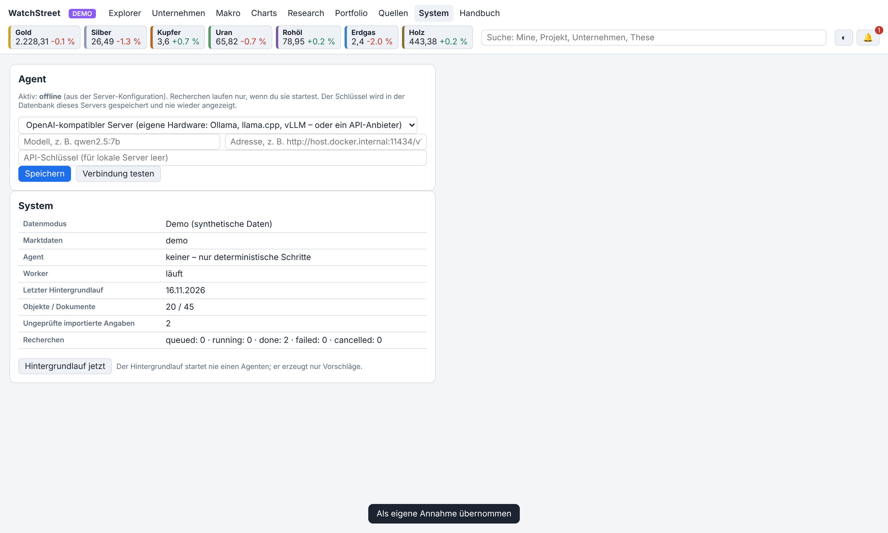

Datenmodus, Marktdatenquelle, konfigurierter Agent, Zustand des Workers. „Hintergrundlauf jetzt“
aktualisiert Preise und Ereignisse und führt die Regelprüfung aus; er startet nie einen Agenten.

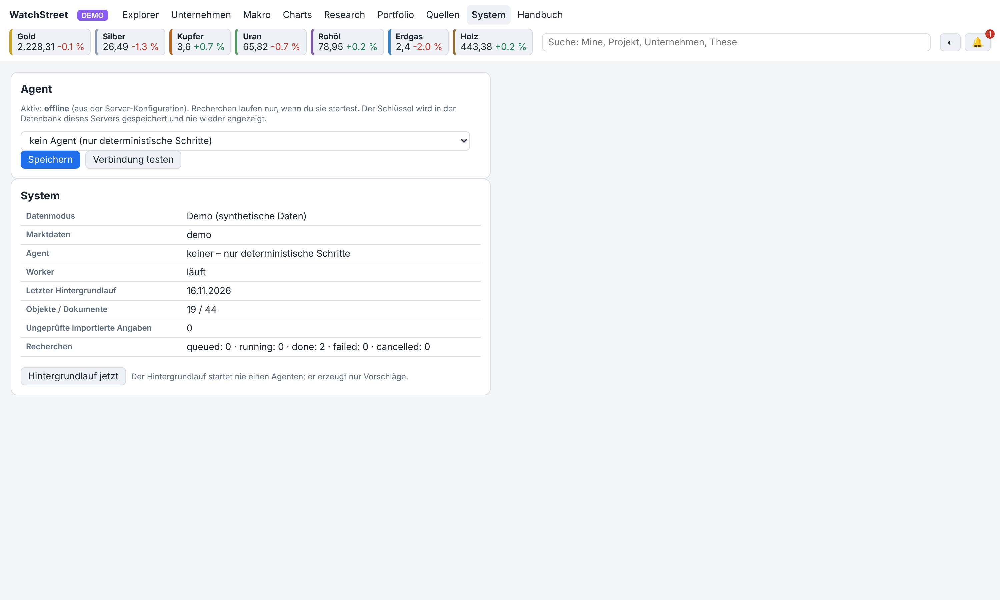

## 13. Betrieb

| Zweck | Befehl |
|---|---|
| Demo ohne Netz und Schlüssel | `make demo` → http://localhost:8000 |
| Mit Docker und PostgreSQL | `docker compose up --build` |
| Öffentlich mit HTTPS und Anmeldung | siehe `docs/deployment.md` |
| Lokales Modell (llama.cpp) | `docker compose --profile llm-cpu up --build` bzw. `llm-gpu`, dazu `WATCHSTREET_AGENT_RUNNER=llama` |

Einstellungen stehen in `.env.example`. Ohne konfigurierten Agenten (`offline`) arbeitet WatchStreet
nur mit deterministischen Schritten.

**Sicherung:** bei PostgreSQL `docker compose exec db pg_dump -U watchstreet watchstreet > backup.sql`;
vor einem Update immer sichern, denn Migrationen sind nicht in jedem Fall umkehrbar.

## 13a. Glossar

| Begriff | Bedeutung in einem Satz |
|---|---|
| AISC | „All-in Sustaining Costs“: was die Förderung einer Einheit kostet, inklusive der Investitionen, um die Mine am Laufen zu halten |
| Cash Cost | reine Betriebskosten je Einheit, ohne Erhaltungsinvestitionen – immer niedriger als AISC |
| Reserven | der Teil der Lagerstätte, dessen Abbau nach einer Studie wirtschaftlich ist |
| Ressourcen (M&I, Inferred) | geschätzte Menge im Boden; „Measured & Indicated“ ist besser belegt, „Inferred“ nur vermutet |
| Gehalt, Ausbringung | wie viel Metall im Gestein steckt und wie viel davon die Anlage herausholt |
| PEA, PFS, FS | Studienstufen eines Projekts, von der ersten Abschätzung (PEA) bis zur Machbarkeitsstudie (FS) |
| Capex | Investition, um ein Projekt zu bauen |
| NPV | heutiger Wert der künftigen Zahlungen eines Projekts laut Studie – hängt stark von der Preisannahme ab |
| NAV | hier: einfacher Barwert des Cashflows einer Mine über die Reservenlaufzeit |
| EV (Unternehmenswert) | Börsenwert plus Schulden minus Kasse: was ein Käufer für das Geschäft zahlt |
| Mittelabfluss (Burn) | Geld, das ein Unternehmen ohne Einnahmen je Quartal verbraucht |
| Reichweite | Monate, bis die Kasse bei diesem Mittelabfluss leer ist |
| Verwässerung | neue Aktien senken deinen Anteil am Unternehmen |
| Verwässerungsüberhang | Optionen und Warrants, die noch zu Aktien werden können, im Verhältnis zu den ausstehenden Aktien |
| Warrant | Recht, bis zu einem Datum Aktien zu einem festen Preis zu kaufen; oft Beigabe einer Finanzierung |
| Royalty, Stream | Anspruch auf einen Teil des Umsatzes oder der Produktion einer Mine, ohne sie zu betreiben |
| Zeichen an Kennzahlen | **B** belegt mit wörtlichem Zitat · **≈** berechnet oder geschätzt · **N** aus einer importierten Analyse, ungeprüft · **E** eigene Annahme · **?** unbekannt |

## 14. Grenzen des aktuellen Stands

* Marge, Cashflow und NAV sind einfache Modellrechnungen (Preis nach Royalties minus Stückkosten,
  8 % Diskontsatz, konstante Produktion) ohne Steuern, Investitionen und Schulden – keine Bewertung.
  Liegt der Preis unter den Kosten, rechnet der NAV mit Stilllegung (0) statt mit Dauerverlust.

* Register liefern nur Ort, Namen und teils Betreiber. Der USGS-Abruf ist mit echten Daten geprüft; der
  Wikidata-Abruf ist gegen aufgezeichnete echte Antworten geprüft, wurde in der Entwicklungsumgebung
  aber von Wikidata abgewiesen (Bot-Richtlinie) und ist im Betrieb noch zu bestätigen.
* Die Hintergrundkarten stammen von freien Diensten ohne Verfügbarkeitszusage und sind für
  gelegentliche Einzelnutzung gedacht. Satellitenbilder fehlen noch.
* Konzessionen gibt es nur, wo ein amtliches Register offen abrufbar ist; angebunden sind bisher
  British Columbia, Ontario, Westaustralien und US-Bundesland; Québec fehlt, weil ich keinen offenen
  Kartendienst bestätigen konnte. Weitere Register sind je eine Zeile in
  `intel/connectors/claims.py`. Die Bilder 26 und 27 stammen aus einem Lauf mit echten Registern
  und werden vom Abnahmeskript nicht neu erzeugt.
* Makro: Gespeichert wird der jeweils aktuelle Stand einer Reihe. Spätere Revisionen (CPI, M2)
  überschreiben den alten Wert; „wie damals veröffentlicht“ gibt es noch nicht. Annahmen einer
  These lassen sich noch nicht an eine Makroreihe mit Schwelle binden. FRED führt den S&P 500 nur für zehn Jahre und keine Währungen von Chile
  oder Peru.
* Charts: Aktienkurse sind Wochenschlusskurse ab dem ersten Abruf des Anbieters, ohne Dividenden und
  Aktiensplits. Wechselkurse gibt es für Kanadischen Dollar, Australischen Dollar und Euro; Aktien
  in anderen Währungen erscheinen in der Matrix ohne Werte. Der Depotwert als Ganzes lässt sich noch
  nicht in einem Massstab zeigen, der Massstab ist noch keine Einstellung der ganzen Anwendung, und
  aus einer Linse lässt sich noch keine Annahme einer These machen. Geprüft ist der Bereich nur mit
  Demo-Daten; die Makroreihen dort sind echte Daten bis zum Snapshot (siehe Abschnitt 10b), die
  Kurse synthetisch. Ein Chart, der beides verbindet, endet deshalb am Stand des Snapshots.
* Rohöl, Erdgas und Holz: Felder, Sägewerke, Waldbesitz und Royalty-Halter sind noch keine Objekte;
  das dafür nötige Modell (Eigentümer und Betreiber getrennt) steht in `docs/spec/product-vision.md`.
  Erdgas wird nie in Barrel umgerechnet.
* Die Anwendung ist für eine Person gebaut (ein Passwort, ein Depot). Anmeldung über Google,
  getrennte Nutzer, Abonnement und Werbung sind Zielbild, nicht Stand.
* Noch nicht vorhanden: Marker-Clustering, Standortbilder, Inflations- und
  Rohstoffäquivalent-Spalten im Vergleich.
* Die Zitatprüfung stellt sicher, dass ein Zitat wörtlich im Dokument steht, nicht, dass es die Zahl
  inhaltlich richtig belegt.
