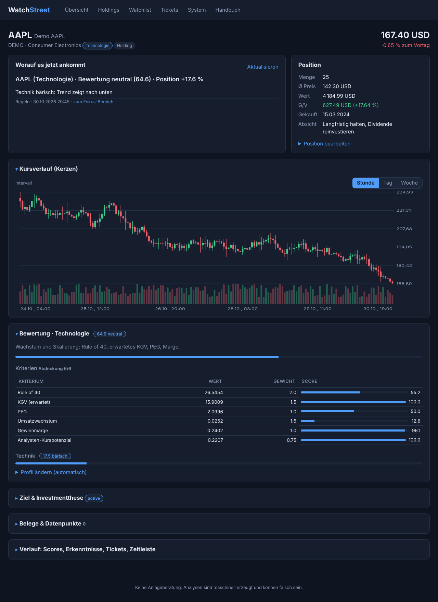
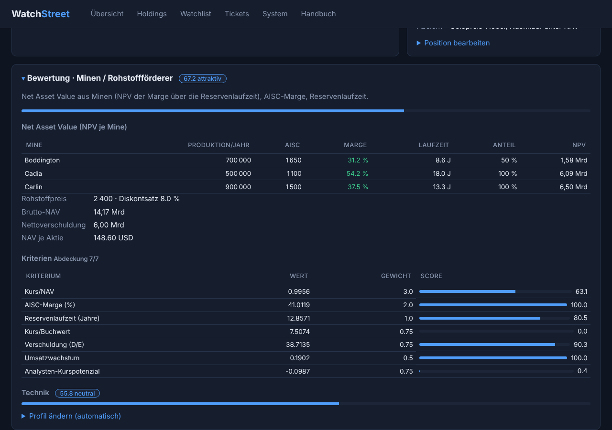
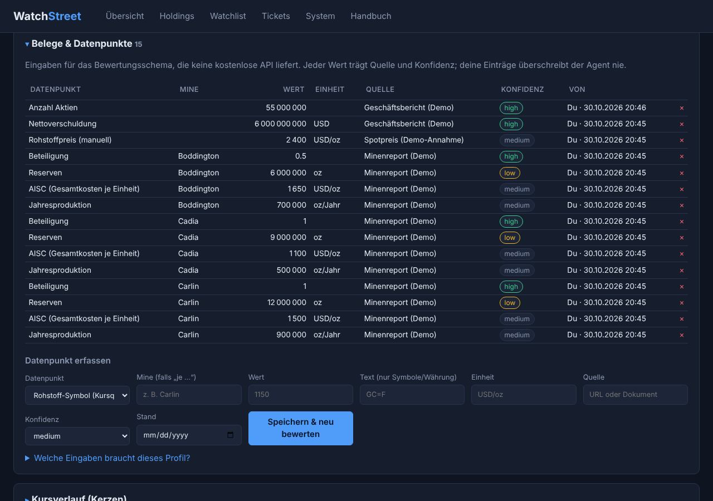
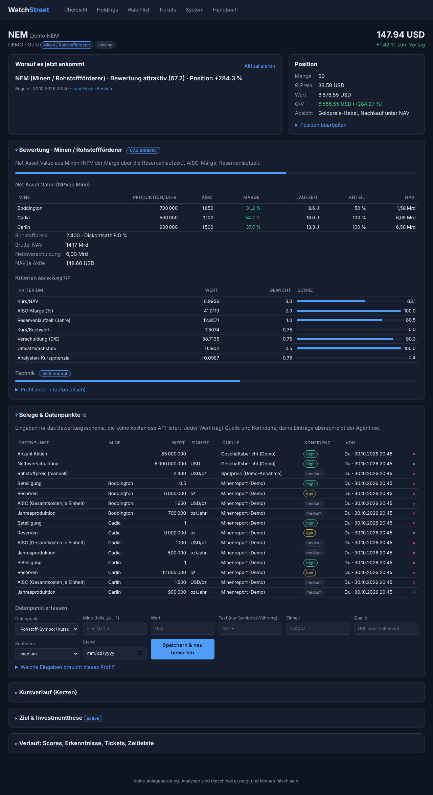
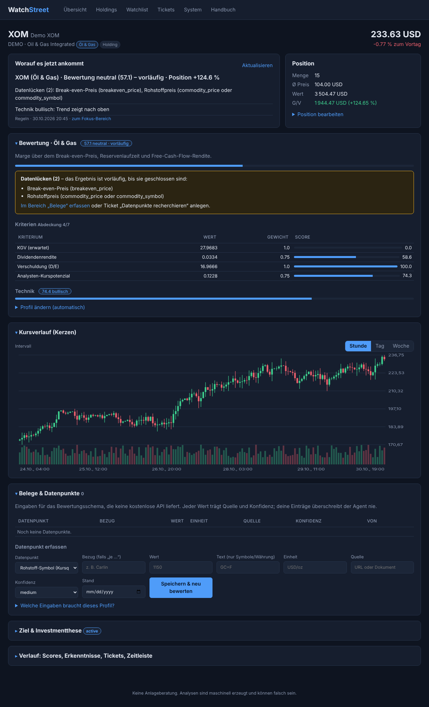

# WatchStreet – Benutzerhandbuch

WatchStreet überwacht deine Aktien. Du trägst ein, was du besitzt (**Holdings**) und was dich interessiert (**Watchlist**). Zu jeder Aktie legt das System **Tickets** an – Analyseaufträge, die automatisch von Agenten abgearbeitet werden. Die Erkenntnisse (Ziel, These, Scores, Hinweise) bleiben an der Aktie erhalten und wachsen mit der Zeit.

> **Hinweis zu den Screenshots:** Sie wurden mit dem Demo-Modus erzeugt (synthetische Kurse, regelbasierter Offline-Agent). Kurse und Texte sind also Beispiele und keine echten Marktdaten. **WatchStreet liefert keine Anlageberatung.**

## 1. Aufruf

Nach `docker compose up --build` ist die Anwendung unter **http://localhost:8000** erreichbar. Oben befindet sich die Navigation: *Übersicht, Holdings, Watchlist, Tickets, System, Handbuch*. Dieses Handbuch ist auch in der Anwendung unter **Handbuch** abrufbar.

## 2. Grundkonzepte

| Begriff | Bedeutung |
|---|---|
| **Holding** | Eine Aktie, die du besitzt: Menge, Ø-Kaufpreis, optional Kaufdatum und Absicht. |
| **Watchlist** | Eine Aktie, die du beobachtest, mit optionaler Notiz. |
| **Ticket** | Ein Auftrag mit genau einem vordefinierten **Workflow**. Status: wartend → läuft → erledigt / fehlgeschlagen / abgebrochen. |
| **Workflow** | Festes Ablaufschema eines Tickets (siehe Abschnitt 8). |
| **Erkenntnis** | Dauerhafte Aussage aus einem Ticket (Kategorien: Ziel, Risiko, Katalysator, Bewertung, Technik, Handlung, Notiz). |
| **Score** | Zahl 0–100 nach einem festen Schema. Jede Messung wird gespeichert, so entsteht ein Verlauf. |
| **These** | Die Investmentthese. Jede Prüfung legt eine neue Version mit Status an. |
| **Folgeticket** | Ein Ticket, das ein abgeschlossenes Ticket vorgeschlagen hat. |

## 3. Übersicht (Dashboard)

* **Depotwert** – Einstand, aktueller Wert und Gewinn/Verlust. Je Währung eine Karte; verschiedene Währungen werden nie zusammengerechnet.
* **Positionen** – Anzahl der Holdings und Watchlist-Einträge.
* **Tickets** – offene, erledigte und fehlgeschlagene Tickets.
* **Harness** – ob der Worker läuft, welcher Agent und welche Datenquelle aktiv sind.
* **Letzte Tickets** und **Neueste Erkenntnisse** – Klick führt zum Ticket bzw. zur Aktie.

## 4. Holdings

**Position eintragen:** Symbol (z. B. `AAPL`, `SAP.DE`; beim Tippen erscheinen Vorschläge), Menge, Ø-Kaufpreis (Komma oder Punkt), optional Kaufdatum und **Absicht** (z. B. „langfristig halten“). Mit *Eintragen & Bestandsaufnahme starten* wird die Position gespeichert und automatisch ein **Bestandsaufnahme-Ticket** angelegt. Ohne Absicht leitet der Agent ein Ziel selbst ab.

**Tabelle:** Kurs, Tagesänderung, Wert und Gewinn/Verlust je Position. Ein Klick auf das Symbol öffnet die Aktie. *Entfernen* löscht nur die Position; Tickets, Erkenntnisse und Thesen bleiben erhalten.

**Fehlermeldungen:** Ungültige Eingaben (z. B. Text statt Zahl, unbekanntes Symbol, doppelte Position) werden angezeigt, deine Eingaben bleiben im Formular stehen.

## 5. Watchlist

Symbol und optional eine Notiz eintragen. Es wird eine **Kaufprüfung** gestartet: Lohnt sich ein Kauf? Das Ergebnis und Folgeanalysen erscheinen an der Aktie. Eine Aktie kann gleichzeitig Holding und Watchlist-Eintrag sein.

## 6. Aktien-Detailseite (geschichtet)

Die Seite ist in **Schichten** aufgebaut, damit viele Informationen nicht gleichzeitig erschlagen:

1. **Kopf** – Kurs, Änderung zum Vortag, **Profil** (Aktientyp) als Badge.
2. **Briefing „Worauf es jetzt ankommt“** – eine Schlagzeile und wenige Stichpunkte (Bewertung, Datenlücken, Risiken, Technik). Es wird nach jeder Änderung automatisch neu erzeugt (zuerst regelbasiert, mit LLM zusätzlich vom Agenten verfeinert), ist gespeichert und zeigt Autor und Zeit. *Aktualisieren* erzeugt es sofort neu; der Link „zum Fokus-Bereich“ springt zum wichtigsten Panel.
3. **Position** – Menge, Ø-Preis, Wert, Gewinn/Verlust; *Position bearbeiten*.
4. **Panels** – aufklappbare Bereiche. **Ihre Reihenfolge richtet sich nach dem Profil**: Bei Minen stehen *Bewertung* und *Belege* oben, bei Tech-Aktien zuerst der *Kursverlauf*. Die ersten beiden Panels sind offen, der Fokus-Bereich des Briefings ebenfalls.

| Panel | Inhalt |
|---|---|
| **Bewertung** | Score nach dem Profil-Schema, Kriterientabelle mit Gewicht und Teil-Score, Datenlücken, ggf. NAV-Aufstellung, Technik-Score, *Profil ändern*. |
| **Kursverlauf (Kerzen)** | Candlestick-Chart mit Volumen; Stunde/Tag/Woche; Mausover zeigt O/H/L/C. |
| **Belege & Datenpunkte** | Alle Eingaben mit Quelle, Konfidenz, Herkunft; Formular zum Erfassen. |
| **Ziel & Investmentthese** | Ziel, aktuelle These mit Status, Versionsverlauf. |
| **Verlauf** | Score-Verlauf, Erkenntnisse, Tickets (auch neue anlegen), Zeitleiste. |

## 6a. Profile und Bewertungsschemata

Jede Aktie hat ein **Profil**, das bestimmt, *wie* sie bewertet wird, welche Eingaben nötig sind und wie die Seite aufgebaut ist.

| Profil | Schema (Kern) | Zusätzliche Eingaben |
|---|---|---|
| **Minen / Rohstoffförderer** | Kurs/NAV, AISC-Marge, Reservenlaufzeit | je Mine: Produktion, AISC, Reserven, Beteiligung; Rohstoffpreis, Nettoverschuldung, Aktienzahl |
| **Öl & Gas** | Marge über Break-even, FCF-Rendite, Reservenlaufzeit | Break-even-Preis, Reserven, Produktion, Free Cash Flow |
| **Technologie** | Rule of 40, erwartetes KGV, PEG, Wachstum | – |
| **Versorger** | Dividende, Verschuldung, KGV, ROE | – |
| **Banken & Finanz** | Kurs/Buchwert gegen ROE, CET1 | CET1-Quote |
| **Immobilien / REIT** | Kurs/FFO, Kurs/NAV, Ausschüttung | FFO und NAV je Aktie |
| **Gesundheit / Pharma** | KGV, Wachstum, Marge | – |
| **Allgemein** | Standardschema aus Kennzahlen | – |

**Wie das Profil entsteht:** Beim Eintragen wird es automatisch aus Sektor und Branche des Datenanbieters abgeleitet. Unklare Fälle bleiben „Allgemein“. Ein Agent darf es per Ticket *Profil bestimmen* korrigieren; **dein manuelles Setzen** (Bewertung → *Profil ändern*) hat immer Vorrang und wird nie überschrieben. Nach einer Änderung wird sofort neu bewertet.

**Rechnen kann der Code, recherchieren der Agent:** Alles, was keine kostenlose API liefert (z. B. welche Minen ein Unternehmen hat und zu welchen Kosten sie fördern), sind **Datenpunkte** mit Quelle und Konfidenz (*high/medium/low*). Du erfasst sie im Panel *Belege*; ein Agent kann sie per Ticket *Datenpunkte recherchieren* eintragen, überschreibt aber nie deine Werte. Berechnungen wie der **NAV** (Barwert der Marge jeder Mine über ihre Reservenlaufzeit, minus Nettoverschuldung, durch Aktienzahl) sind deterministisch und nachvollziehbar in der Bewertung aufgeschlüsselt.

**Datenlücken statt Raten:** Fehlen Eingaben, nennt das Panel *Bewertung* sie ausdrücklich und markiert den Score als **vorläufig**. Der Score wird erst „vollständig“, wenn die Kernkennzahlen (z. B. Kurs/NAV und AISC-Marge bei Minen) berechenbar sind. Weichen Berichtswährung und Aktienwährung ab, wird zusätzlich ein Wechselkurs verlangt.

## 7. Tickets

Die Seite **Tickets** listet alle Tickets, filterbar nach Status.

**Eigenes Ticket anlegen** (Aktien-Seite): Workflow wählen, bei *Themenanalyse* ein Thema angeben (z. B. „Wettbewerb in China“).

**Ticket-Detail:** Workflow, Herkunft (*user, intake, followup, event, schedule*), Priorität, Agent, Zeiten, Parameter, Ergebnis, erzeugte Erkenntnisse und Scores sowie die **Folgetickets**. Dort steht auch, welche vorgeschlagenen Folgetickets die Leitplanken **verworfen** haben und warum. Aktionen: *Erneut ausführen* (fehlgeschlagen/abgebrochen), *Abbrechen* (wartend).

**Leitplanken für Folgetickets:** nur bekannte Workflows, maximal 2 Ebenen Tiefe, maximal 4 Folgetickets je Ticket, höchstens 8 offene Tickets je Aktie, keine Duplikate innerhalb von 24 Stunden.

## 8. Workflows

| Workflow | Zweck | LLM |
|---|---|---|
| Bestandsaufnahme (Holding) | Ausgangslage, Ziel, These, Scores; schlägt Folgetickets vor. Wird beim Eintragen automatisch angelegt. | ja |
| Kaufprüfung (Watchlist) | Lohnt sich ein Kauf? Wird beim Beobachten automatisch angelegt. | ja |
| Themenanalyse | Vertiefung zu einem frei wählbaren Thema. | ja |
| Ereignis-Prüfung | Bewertet neue Meldungen auf Relevanz für die These. Wird automatisch angelegt. | ja |
| These prüfen | Testet die These gegen neue Daten und Score-Änderungen; setzt den Thesen-Status. | ja |
| Bewertungs-Score | Deterministisches, **profilabhängiges** Schema (siehe 6a) inkl. NAV/Marge-Berechnung. Wird nach jedem neuen Datenpunkt automatisch neu gestartet. | nein |
| Profil bestimmen | Ordnet die Aktie einem Typ zu. | ja |
| Datenpunkte recherchieren | Trägt fehlende Eingaben mit Quelle und Konfidenz ein; rät nicht. | ja |
| Briefing | Erzeugt „Worauf es jetzt ankommt“ (Regeln, optional vom Agenten verfeinert). Läuft automatisch nach jeder Änderung. | optional |
| Technik-Snapshot | Deterministisch: Kurs vs. SMA50, SMA20 vs. SMA50, Momentum, RSI aus Stundenkerzen. | nein |

Scores werden aus den verfügbaren Eingaben berechnet und nur gebildet, wenn mindestens drei Kriterien vorliegen; die *Abdeckung* (z. B. 7/10) ist angegeben.

## 9. Automatik (Worker)

Der Worker läuft als eigener Container. Er

* arbeitet wartende Tickets nach Priorität ab (manuell/Intake vor Folge- und Zeitplan-Tickets),
* prüft **stündlich** (einstellbar) alle Aktien auf neue Meldungen und legt dafür eine Ereignis-Prüfung an,
* frischt Analysen auf: Technik-Snapshot täglich, Bewertungs-Score und These wöchentlich – nur für Aktien mit abgeschlossener Bestandsaufnahme,
* setzt nach einem Absturz hängende Tickets (> 30 min *läuft*) zurück in die Warteschlange.

## 10. System

Zeigt Datenquelle, Agent, Worker-Status, letzten Scan und alle Workflows.

**Datenquellen:** `yahoo` (kostenlos, ohne Schlüssel, Kurse stundengenau) oder `demo` (synthetisch, offline).
**Agenten (`WATCHSTREET_AGENT_RUNNER`):** `llama` (lokales llama.cpp im Docker-Verbund), `offline` (regelbasiert, kein LLM – kann Freitext-Themen nicht inhaltlich analysieren), `anthropic` (API-Schlüssel nötig), `openai` (OpenAI-kompatibel, z. B. lokales Ollama), `cli` (externer Agent per Kommandozeile, z. B. `claude -p`). Konfiguration in `.env`, siehe `.env.example`.

## 11. Lokales LLM, Datenbank und Tool-Calling

* **Datenbank:** Postgres läuft als eigener Container, die Dateien liegen im Projektordner unter `data/postgres`.
* **Lokales Modell:** GGUF-Datei in den Ordner `models/` legen (`scripts/download_model.sh <url>`), in `.env` `LLAMA_MODEL=<datei>` und `WATCHSTREET_AGENT_RUNNER=llama` setzen und mit `docker compose --profile llm-gpu up --build` (NVIDIA-GPU) bzw. `--profile llm-cpu` starten. Grenzen für GPU-Anzahl, GPU-Schichten, Threads, Kontext und RAM stehen in `.env` (`LLAMA_*`). Empfohlen sind Instruct-Modelle mit Tool-Unterstützung.
* **Tool-Calling:** Der Harness berechnet Kurs, Kennzahlen, Scores und Gewinn/Verlust selbst und gibt dem Agenten nur ein kompaktes Faktenblatt. Details holt der Agent bei Bedarf über Tools und hält Ergebnisse (Erkenntnis, Ziel, These, Folgeticket, Datenpunkt mit Quelle, Profil) ebenfalls über Tools fest. Ablehnungen der Leitplanken (z. B. Duplikat) bekommt der Agent sofort zurückgemeldet. Im Ticket-Detail zeigt **Modus** die Schritte, Tool-Aufrufe und Tokens. Unterstützt das Modell keine Tools, wechselt der Harness automatisch auf JSON-Antworten (Modus `json`).

## 12. Grenzen und Hinweise

* Yahoo-Daten kommen aus einer inoffiziellen, kostenlosen Schnittstelle; sie kann sich ändern oder Anfragen begrenzen. Fehlende Kennzahlen führen zu weniger Kriterien, nicht zu erfundenen Werten.
* Zahlen und Texte können falsch sein. Keine Anlageberatung.
* Währungen werden nicht umgerechnet; bei Minen mit abweichender Berichtswährung ist ein Wechselkurs als Datenpunkt nötig.
* Ein lokales LLM hat keinen Internetzugriff: Recherchierte Datenpunkte stammen aus dem Modellwissen und sind entsprechend mit Konfidenz zu lesen. Prüfe sie, bevor du dich auf sie verlässt.
* Beim Update von einer älteren Version fehlen neue Tabellenspalten (keine Migrationen): lokale Datenbank (`data/`) neu anlegen.
* Es gibt noch keine Benutzerverwaltung: Die Anwendung gehört in ein vertrauenswürdiges Netz.
